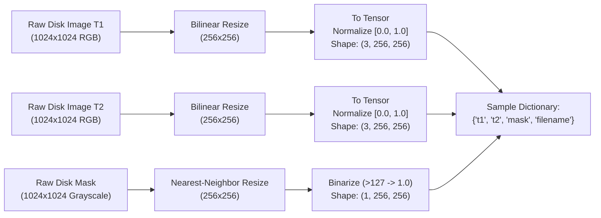

# Data Preprocessing & Ingestion Pipeline Specification

**Project:** Satellite Land Use Change and Encroachment Detector  
**Course:** Deep Learning PBL / Project 50  
**Phase:** Phase 2 — Dataset Acquisition, Inspection and Preparation  
**Module:** `src/dataset.py` & `tests/test_dataset.py`  
**Status:** ✅ Fully Implemented, Unit Tested & Verified  

---

## 1. Overview and Design Rationale

The original LEVIR-CD benchmark consists of high-resolution aerial images of dimension $1024 \times 1024$ pixels. Feeding full $1024 \times 1024 \times 3$ image pairs directly into a convolutional neural network on unified-memory Apple Silicon hardware would:
1. Demand substantial GPU/MPS VRAM ($\approx 4\times$ to $16\times$ higher activation memory per batch), forcing tiny batch sizes ($B=1$ or $B=2$).
2. Stochastically destabilize batch normalization statistics due to micro-batch sizes.
3. Preclude rapid iterative experimentation during training.

To solve this cleanly without duplicating gigabytes of files on limited disk space, we implemented an **on-the-fly preprocessing pipeline** inside a custom PyTorch `torch.utils.data.Dataset` (`LEVIRCDDataset`).

---

## 2. Ingestion & Transformation Pipeline



### 2.1 Interpolation Method Selection

| Asset Type | Interpolation Algorithm | Technical Justification |
|---|---|---|
| **Pre-Change ($T_1$) & Post-Change ($T_2$) Images** | **Bilinear Interpolation** (`InterpolationMode.BILINEAR`) | Smooths continuous color gradients and prevents aliasing or jagged edge artifacts in natural satellite imagery. |
| **Change Label Mask** | **Nearest-Neighbor Interpolation** (`InterpolationMode.NEAREST`) | **Critical requirement.** Preserves discrete class labels ($0$ or $1$) and sharp boundary transitions without generating intermediate floating-point gray fringes along building perimeters. |

### 2.2 Mask Binarization and Value Range
The raw ground-truth raster masks contain anti-aliasing values from earlier benchmark rendering (`[0, 156, 254, 255]`).
In `src/dataset.py`, the mask is explicitly binarized:
```python
# Convert to tensor and binarize: values > 127 become 1.0, otherwise 0.0
mask_tensor = torch.from_numpy(np.array(mask, dtype=np.uint8)).unsqueeze(0)
mask_tensor = (mask_tensor > 127).to(torch.float32)
```
- Background pixels $\to 0.0$
- Changed building pixels $\to 1.0$
- Tensor output shape: `torch.Size([1, 256, 256])` of type `torch.float32`.

### 2.3 Image Normalization
RGB values spanning integers $[0, 255]$ are converted to floating-point values in the range $[0.0, 1.0]$:
```python
t1_tensor = torchvision.transforms.functional.to_tensor(t1)  # Range [0.0, 1.0]
t2_tensor = torchvision.transforms.functional.to_tensor(t2)  # Range [0.0, 1.0]
```
- Tensor output shape: `torch.Size([3, 256, 256])` of type `torch.float32`.

---

## 3. Implementation Details (`src/dataset.py`)

### 3.1 Class Structure: `LEVIRCDDataset`
Inherits from `torch.utils.data.Dataset`:
- **Initialization:**
  ```python
  dataset = LEVIRCDDataset(
      data_dir="data",
      split="train",  # 'train', 'val', or 'test'
      img_size=256,
      transform=None
  )
  ```
- **Integrity Validation on Init:** Scans directories `A/`, `B/`, and `label/`, matches corresponding filenames across all three directories, and raises descriptive errors if any file is missing or mismatched.
- **Length Query (`__len__`):** Returns the exact count of verified pairs (445 for train, 64 for val, 128 for test).
- **Indexing (`__getitem__`):** Loads the triplet lazily, applies resizing, binarizes the mask, and returns a dictionary:
  ```python
  {
      't1': torch.Tensor,       # Shape: [3, 256, 256], dtype: float32
      't2': torch.Tensor,       # Shape: [3, 256, 256], dtype: float32
      'mask': torch.Tensor,     # Shape: [1, 256, 256], dtype: float32
      'filename': str           # e.g., 'train_1.png'
  }
  ```

### 3.2 Factory Function: `get_dataloader`
Provides a clean constructor for PyTorch data loaders with Apple Silicon hardware-aware defaults:
```python
def get_dataloader(
    data_dir: str = "data",
    split: str = "train",
    batch_size: int = 8,
    shuffle: bool = True,
    num_workers: int = 0,
    img_size: int = 256
) -> DataLoader
```

#### Apple Silicon MPS Compatibility Adjustments:
1. **`pin_memory` handling:** PyTorch raises a runtime warning when `pin_memory=True` is enabled on Apple Silicon MPS (`'pin_memory' argument is set as true but not supported on MPS now`). The factory dynamically sets `pin_memory=torch.cuda.is_available()`, safely disabling it on MPS while keeping CUDA portability.
2. **`num_workers` handling:** Set to `0` by default on macOS to avoid multiprocessing spawn overhead and POSIX semaphore contention, while ensuring smooth tensor streaming.

---

## 4. Verification and Automated Unit Testing

An automated test suite was developed in `tests/test_dataset.py` verifying:
1. **Initialization:** Confirms dataset successfully discovers all 445 train pairs, 64 validation pairs, and 128 test pairs.
2. **Sample Shapes & Value Ranges:**
   - $T_1$ shape: `torch.Size([3, 256, 256])`, values in $[0.0, 1.0]$.
   - $T_2$ shape: `torch.Size([3, 256, 256])`, values in $[0.0, 1.0]$.
   - $\text{Mask}$ shape: `torch.Size([1, 256, 256])`, unique values strictly subset of $\{0.0, 1.0\}$.
3. **DataLoader Batching:** Confirms a batch size of $4$ outputs batches of `[4, 3, 256, 256]` for imagery and `[4, 1, 256, 256]` for labels.

### Execution Output:
```
======================================================================
Ran 3 tests in 0.174s

OK
```

---

## 5. Next Phase Integration (Phase 3)

The completed `LEVIRCDDataset` module is directly consumable by the Siamese U-Net training pipeline:
```python
from src.dataset import get_dataloader

train_loader = get_dataloader(data_dir="data", split="train", batch_size=8, shuffle=True)
val_loader   = get_dataloader(data_dir="data", split="val",   batch_size=8, shuffle=False)

for batch in train_loader:
    t1   = batch['t1'].to(device)    # [8, 3, 256, 256]
    t2   = batch['t2'].to(device)    # [8, 3, 256, 256]
    mask = batch['mask'].to(device)  # [8, 1, 256, 256]
    # Forward pass through Siamese U-Net in Phase 3
```

