# Final Model Selection, Optimisation & Validation Report (Phase 8)

**Project:** Satellite Land Use Change and Encroachment Detector  
**Course:** Deep Learning PBL / Project 50  
**Phase:** Phase 8 — Final Model Selection, Optimisation & Validation  
**Date:** November 3, 2026  
**Status:** ✅ Fully Completed, Benchmarked, Tested & Validated  

---

## 1. Executive Summary & Experimental Methodology

Phase 8 establishes the final production architecture for bitemporal satellite building change detection through a fair, head-to-head empirical competition between our two top architectural candidates.

### 1.1 Non-Negotiable Experimental Safeguards:
1. **Zero Blind Test Leakage:** The $128$-pair test set remained **100% untouched**. In accordance with rigorous machine learning standards, model selection was conducted exclusively using the $64$-pair validation set.
2. **Benchmark Immutability:** The historical Phase 5/6 checkpoint (`outputs/checkpoints/best_model.pt`) and its blind test evaluation ($F_1 = 72.78\%$, $\text{IoU} = 57.21\%$) remain immutable as our historical baseline and are not conflated with validation metrics.
3. **Controlled Single-Variable Methodology:** Both candidate networks were trained under identical conditions:
   - **Training Set:** 445 registered pairs (LEVIR-CD)
   - **Validation Set:** 64 registered pairs (LEVIR-CD)
   - **Input Dimensions:** $256 \times 256$ pixels
   - **Batch Size:** 4
   - **Hardware Backend:** Apple Silicon GPU (`mps`)
   - **Optimizer:** AdamW ($\eta = 0.001$, $\beta_1 = 0.9$, $\beta_2 = 0.999$, weight decay $\lambda = 10^{-4}$)
   - **Learning Rate Scheduler:** Cosine Annealing ($T_{\max} = 15$, $\eta_{\min} = 10^{-5}$)
   - **Loss Function:** Composite Loss ($0.50\text{ BCE} + 0.50\text{ Soft Dice}$)
   - **Random Seed:** 42 across Python, NumPy, and PyTorch

---

## 2. Candidate Architectures

```mermaid
flowchart TD
    subgraph CandidateA["Candidate A: Siamese U-Net (Diff Skips)"]
        A_Enc["Shared 4-Stage Encoder\n(16 -> 32 -> 64 -> 128 -> 256)"]
        A_Diff["Diff Skip Fusion:\n|F_T1 - F_T2| (C channels)"]
        A_Dec["Decoder with C-channel Skips"]
        A_Out["Output Head: 1x1 Conv"]
        A_Enc --> A_Diff --> A_Dec --> A_Out
    end

    subgraph CandidateB["Candidate B: Siamese U-Net (Concat Skips)"]
        B_Enc["Shared 4-Stage Encoder\n(16 -> 32 -> 64 -> 128 -> 256)"]
        B_Concat["Concat Skip Fusion:\n[F_T1, F_T2] (2C channels)"]
        B_Dec["Expanded Decoder with 2C Skips"]
        B_Out["Output Head: 1x1 Conv"]
        B_Enc --> B_Concat --> B_Dec --> B_Out
    end
```



### Architectural Distinctions:
- **Candidate A (`SiameseUNet`):** Enforces temporal symmetry by computing the element-wise absolute difference $\Delta F_i = |F_{T1}^{(i)} - F_{T2}^{(i)}|$ across all 4 encoder stages. The decoder receives $C$ skip channels at each scale. Total parameters: **$1,964,097$** ($7.49\text{ MB}$).
- **Candidate B (`SiameseUNetConc`):** Concatenates raw temporal feature maps $S_i = [F_{T1}^{(i)}, F_{T2}^{(i)}]$ along the channel dimension ($2C$ channels) at the bottleneck and skip connections. This gives the decoder double the representational capacity to model non-linear asymmetric interactions. Total parameters: **$3,930,433$** ($14.99\text{ MB}$).

---

## 3. Fair 15-Epoch Training Comparison

Both models were trained from scratch for 15 full epochs. Validation loss, Precision, Recall, F1-Score, and IoU were tracked at every epoch.

### 3.1 Training & Validation Metrics Progression Table

| Epoch | Candidate A: Train Loss | Candidate A: Val Loss | Candidate A: Val F1 | Candidate B: Train Loss | Candidate B: Val Loss | Candidate B: Val F1 |
|:---:|:---:|:---:|:---:|:---:|:---:|:---:|
| 1 | $0.6974$ | $0.6165$ | $44.81\%$ | $0.6478$ | $0.5536$ | $64.82\%$ |
| 2 | $0.5426$ | $0.5020$ | $58.02\%$ | $0.4999$ | $0.4816$ | $63.62\%$ |
| 3 | $0.4379$ | $0.4648$ | $43.26\%$ | $0.4084$ | $0.3851$ | $73.55\%$ |
| 4 | $0.3636$ | $0.5706$ | $35.89\%$ | $0.3391$ | $0.3655$ | $66.17\%$ |
| 5 | $0.3134$ | $0.4042$ | $49.14\%$ | $0.2917$ | $0.3619$ | $61.34\%$ |
| 6 | $0.2833$ | $0.3547$ | $62.41\%$ | $0.2679$ | $0.2625$ | $79.20\%$ |
| 7 | $0.2526$ | $0.3335$ | $65.41\%$ | $0.2433$ | $0.2609$ | $78.48\%$ |
| 8 | $0.2358$ | $0.3081$ | $68.54\%$ | $0.2231$ | $0.2537$ | $78.27\%$ |
| 9 | $0.2270$ | $0.4116$ | $51.37\%$ | $0.2160$ | $0.2854$ | $73.31\%$ |
| 10 | $0.2184$ | $0.3551$ | $60.38\%$ | $0.2092$ | $0.2492$ | $77.76\%$ |
| 11 | $0.2108$ | $0.3603$ | $59.88\%$ | $0.2014$ | $0.2592$ | $75.57\%$ |
| 12 | $0.2003$ | $0.3230$ | $68.51\%$ | $0.1915$ | $0.2345$ | $80.71\%$ |
| 13 | $0.1931$ | $0.3243$ | $68.61\%$ | **$0.1869$** | **$0.2249$** | **$82.26\%$ (★)** |
| 14 | **$0.1885$** | **$0.3005$** | **$72.69\%$ (★)** | $0.1839$ | $0.2277$ | $81.98\%$ |
| 15 | $0.1885$ | $0.3293$ | $67.43\%$ | $0.1842$ | $0.2276$ | $81.70\%$ |

---

## 4. Head-to-Head Comparison & Efficiency Analysis

### 4.1 Master Benchmark Comparison Table

| Metric / Dimension | Candidate A (Diff Skips) | Candidate B (Concat Skips) | Delta ($\Delta = \text{B} - \text{A}$) | Scientific Meaning |
|---|:---:|:---:|:---:|---|
| **Architecture Class** | `SiameseUNet` | `SiameseUNetConc` | — | Channel-expanded decoder |
| **Trainable Parameters** | **$1,964,097$** | $3,930,433$ | $+1,966,336$ ($+100.1\%$) | $2\times$ parameters in decoder blocks |
| **Model Size (Float32)** | **$7.49\text{ MB}$** | $14.99\text{ MB}$ | $+7.50\text{ MB}$ ($+100.1\%$) | Highly manageable for local edge inference |
| **Best Val Epoch** | Epoch 14 | **Epoch 13** | $-1$ epoch | Candidate B converged faster |
| **Val Loss (Best Epoch)** | $0.3005$ | **$0.2249$** | **$-0.0756$** ($-25.2\%$) | Significantly lower prediction error |
| **Default ($\tau = 0.50$) Val F1** | $72.69\%$ | **$82.26\%$** | **$+9.57\%$** | Superior un-tuned baseline overlap |
| **Default ($\tau = 0.50$) Val IoU** | $57.09\%$ | **$69.86\%$** | **$+12.77\%$** | Substantially higher mask tightness |
| **Optimal Threshold ($\tau^*$)** | $\tau^* = 0.20$ | $\tau^* = 0.20$ | $0.00$ | Identical optimal threshold point |
| **Tuned Val Precision** | $79.73\%$ | **$83.77\%$** | **$+4.04\%$** | Fewer false alarms on vegetation/roads |
| **Tuned Val Recall** | $70.00\%$ | **$82.13\%$** | **$+12.13\%$** | Far fewer missed building structures |
| **Tuned Val F1-Score** | $74.55\%$ | **$82.94\%$** | **$+8.39\%$** | Major leap in harmonic segmentation quality |
| **Tuned Val IoU** | $59.43\%$ | **$70.85\%$** | **$+11.42\%$** | $+11.4\%$ tighter bounding boundaries |
| **Inference Latency (MPS)** | **$9.29\text{ ms}$** | $18.08\text{ ms}$ | $+8.79\text{ ms}$ | Modest increase due to convolution width |
| **Throughput (FPS)** | **$107.7\text{ FPS}$** | $55.3\text{ FPS}$ | $-52.4\text{ FPS}$ | **$55.3\text{ FPS}$ comfortably exceeds $30\text{ FPS}$ real-time** |
| **Total Training Time** | **$481.4\text{ s}$** ($8.0\text{ min}$) | $703.6\text{ s}$ | $+222.2\text{ s}$ ($+3.7\text{ min}$) | Minimal compute overhead on Apple Silicon |

### 4.2 Historical Context: Phase 5 & 6 vs. Phase 8

| Model & Split | Epochs Trained | Parameters | Val F1 (%) | Val IoU (%) | Blind Test F1 (%) | Blind Test IoU (%) | Notes |
|---|:---:|:---:|:---:|:---:|:---:|:---:|---|
| **Phase 5 Siamese U-Net (`best_model.pt`)** | 10 | $1.96\text{M}$ | $73.44\%$ | $58.03\%$ | — | — | Original validation benchmark |
| **Phase 6 Blind Test Baseline** | — | $1.96\text{M}$ | — | — | **$72.78\%$** | **$57.21\%$** | **Historical Blind Benchmark (Untouched)** |
| **Phase 8 Candidate A (Diff Skips)** | 15 | $1.96\text{M}$ | $74.55\%$ | $59.43\%$ | *(Untested)* | *(Untested)* | Reached plateau around Epoch 14 |
| **Phase 8 Candidate B (Concat Skips)** | 15 | $3.93\text{M}$ | **$82.94\%$** | **$70.85\%$** | *(Untested)* | *(Untested)* | **Final Selected Production Model** |

> [!IMPORTANT]
> **Zero Blind Test Leakage Guarantee:** In adherence to strict scientific evaluation guidelines, Candidate B was **never** evaluated on the Phase 6 test set. The Phase 6 test metrics ($F_1 = 72.78\%$, $\text{IoU} = 57.21\%$) remain historical benchmark figures for the original model.

---

## 5. Final Model Selection Decision

### **Selected Winner: Candidate B (`SiameseUNetConc`)**

### Rationale:
1. **Unquestionable Accuracy Superiority:** Candidate B achieved **$82.94\%$ validation F1** and **$70.85\%$ validation IoU**, outperforming Candidate A by **$+8.39\%$ F1** and **$+11.42\%$ IoU**. In building change detection, an $11\%$ IoU increase dramatically reduces fragmented, noisy boundaries around building edges.
2. **Exceptional Recall Gain ($+12.13\%$):** Recall increased from $70.00\%$ to $82.13\%$. In illegal encroachment monitoring, false negatives (missed building construction) are far more dangerous than false positives. Candidate B captures significantly more verified building developments.
3. **Real-World Deployment Viability:** Although parameter count doubled from $1.96\text{M}$ to $3.93\text{M}$, the checkpoint size is only **$14.99\text{ MB}$**, and single-pair inference latency is **$18.08\text{ ms}$** on Apple Silicon GPU ($55.3\text{ FPS}$). This throughput exceeds standard real-time requirements ($30\text{ FPS}$) by nearly $2\times$.
4. **Primary Artifact:** The optimal checkpoint has been serialized to [`outputs/checkpoints/final_selected_model.pt`](file:///Users/ananyasingh/Documents/UPES/Semester%205/Deep%20Learning%20Lab/satellite-change-detector/outputs/checkpoints/final_selected_model.pt).

---

## 6. Standalone Inference Pipeline (`src/inference.py`)

A fully decoupled, production-grade inference engine has been developed with the following features:
- **Clean Decoupling:** Does not import any training routines, loss functions, or dataset manifests.
- **Dynamic Checkpoint Inspection:** Reads checkpoint metadata to automatically instantiate either `SiameseUNet` or `SiameseUNetConc`, applying the calibrated threshold $\tau^* = 0.20$.
- **Multi-Format Input:** Accepts file paths (`str`), PIL Images, or NumPy arrays ($H \times W \times 3$).
- **Exact Preprocessing:** Bilinear spatial resizing to $256 \times 256$, normalization to $[0.0, 1.0]$.
- **Original-Resolution Mapping:** Bilinear back-interpolation ensures masks and probability heatmaps match the original input resolution (e.g. $1024 \times 1024$).
- **4-Panel Visualizer:** Produces high-resolution comparative diagnostic grids ($T_1$, $T_2$, Probability Heatmap, and Red Mask Overlay on $T_2$).
- **Defensive Error Handling:** Validates file existence, image readability, channel alignment, and threshold ranges.

### Example CLI Usage:
```bash
python src/inference.py \
  --t1 data/val/A/val_1.png \
  --t2 data/val/B/val_1.png \
  --output outputs/inference_sample_val_1.png \
  --checkpoint outputs/checkpoints/final_selected_model.pt \
  --threshold 0.20
```

### Example Python API Usage:
```python
from src.inference import ChangeDetectorInference

# Initialize inference engine
detector = ChangeDetectorInference(
    checkpoint_path="outputs/checkpoints/final_selected_model.pt",
    default_threshold=0.20
)

# Run prediction
result = detector.predict("path/to/t1.png", "path/to/t2.png")
print(f"Changed Pixels: {result.changed_pixels:,} ({result.change_percentage:.2f}%)")

# Save diagnostic overlay
detector.save_visualization("path/to/t1.png", "path/to/t2.png", result, "outputs/prediction_overlay.png")
```

---

## 7. Viva Voce Defense Examination Q&A (Phase 8 Focus)

### Q1: Why did we train both candidates for 15 epochs instead of relying on the 6-epoch Phase 7 ablation results?
> **Answer:** In early training stages (e.g. 6 epochs), models have not yet converged and learning rates remain elevated. Candidate B appeared promising in Phase 7, but declaring it the winner without an extended, standardized trial would violate scientific rigor. Training both models for 15 epochs under identical conditions confirmed that Candidate B's advantage is sustained ($82.94\%$ vs $74.55\%$), rather than a transient artifact of early-epoch optimization.

### Q2: Why did Candidate B (Concatenation Skips) outperform Candidate A (Difference Skips)?
> **Answer:** In Candidate A, computing $|F_{T1} - F_{T2}|$ forcibly collapses both feature representations into a single difference channel $C$. In Candidate B, concatenating $[F_{T1}, F_{T2}]$ delivers $2C$ channels to each decoder stage. This allows the decoder to learn non-linear cross-attention patterns and contextual feature interactions between pre- and post-disaster/construction imagery, resulting in $+8.39\%$ higher F1 and $+12.13\%$ higher recall.

### Q3: What is the computational trade-off associated with Candidate B?
> **Answer:** Candidate B requires double the parameters ($3.93\text{M}$ vs $1.96\text{M}$) and checkpoint size ($15.0\text{ MB}$ vs $7.5\text{ MB}$), with inference latency increasing from $9.29\text{ ms}$ to $18.08\text{ ms}$. However, $18.08\text{ ms}$ equates to $55.3\text{ FPS}$ on Apple Silicon GPU, which easily surpasses real-time video/interactive processing requirements ($30\text{ FPS}$). The $+8.39\%$ F1 and $+11.42\%$ IoU gain vastly outweighs the negligible latency overhead.

### Q4: Why must final model selection be conducted on the validation set rather than the test set?
> **Answer:** Evaluating candidate models repeatedly on the test set to pick the highest score causes **test-set data leakage** (optimizing hyperparameters on the test distribution). Once a test set is used for selection, it ceases to be an unbiased proxy for real-world generalization. The validation set is reserved for selection; the test set must remain unseen until final deployment benchmarking.

### Q5: Why did both models converge to an optimal probability threshold of $\tau^* = 0.20$ instead of the default $0.50$?
> **Answer:** In remote sensing change detection, class imbalance is extreme: building changes occupy only $\approx 5\%$ of pixels. Under a symmetric threshold of $0.50$, the model under-predicts subtle building edge changes. Lowering the decision boundary to $\tau^* = 0.20$ dramatically boosts Recall ($+12.13\%$) while preserving high Precision ($83.77\%$), maximizing the harmonic F1-score and IoU.

### Q6: What is the difference between validation metrics and blind test metrics?
> **Answer:** Validation metrics measure performance on data used iteratively to tune hyperparameters, select thresholds, and choose architectures. Blind test metrics evaluate the frozen model on completely isolated data that had zero influence on any design choice. Our Phase 6 test metrics ($72.78\%$ F1, $57.21\%$ IoU) represent historical blind performance on the original model and must never be conflated with Phase 8 validation metrics.

### Q7: How does our inference pipeline decouple from training infrastructure?
> **Answer:** `src/inference.py` does not import dataset classes, training loops, loss functions, or experiment trackers. It loads weights directly into pure PyTorch `nn.Module` evaluation mode (`eval()`, `torch.no_grad()`), operates on raw image inputs (paths, PIL, NumPy), and self-contained preprocessing utilities. This ensures the module can be deployed independently into cloud microservices or edge containers without training dependencies.

### Q8: What happens when input satellite images have non-standard dimensions?
> **Answer:** The inference pipeline dynamically captures the input's original dimensions $(W, H)$, resizes the imagery to the model's receptive field ($256 \times 256$) via Bilinear interpolation for tensor forward passes, and then re-interpolates the output probability map back to $(W, H)$. This guarantees pixel-level alignment with the source GIS coordinate system without distorting the underlying model.

### Q9: Why is high Recall particularly crucial in illegal encroachment detection?
> **Answer:** In illegal land encroachment and unauthorized construction monitoring, the cost of a False Negative (a missed unauthorized building) is far more severe than a False Positive (flagging a permissible structure for manual audit). Candidate B achieved $82.13\%$ Recall (compared to Candidate A's $70.00\%$), capturing significantly more unauthorized structures for municipal verification.

### Q10: How do we prevent silent failures during batch inference in production?
> **Answer:** The inference engine enforces defensive input validation: verifying file existence before reading, validating color channel formats (converting RGBA/Grayscale to RGB), checking mathematical bounds on probability thresholds ($0 < \tau < 1$), and providing informative exceptions (`FileNotFoundError`, `ValueError`, `TypeError`) rather than crashing deep within PyTorch tensor operations.

