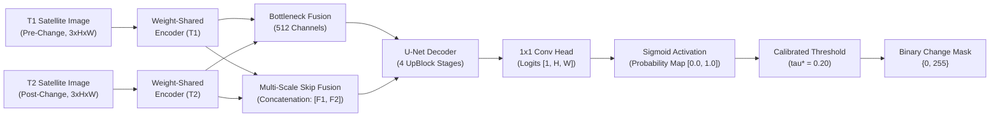

# Interview Guide 1: Project Overview, Motivation & Tech Stack

**Project:** Satellite Land Use Change and Encroachment Detector  
**Domain:** Deep Learning · Computer Vision · Remote Sensing / GIS  
**Course & Academic Context:** Deep Learning PBL (Project 50) — UPES, Semester 5  

---

## 1. The 60-Second "Elevator Pitch" (How to Introduce the Project)

> *"In this project, I built an end-to-end deep learning system that analyzes bitemporal satellite imagery—two optical satellite images of the same geographic location taken at different points in time—to automatically detect and segment structural land changes, specifically new building construction and urban expansion.*
> 
> *The core challenge in satellite change detection is that traditional pixel differencing fails due to seasonal sunlight changes, shadows, and soil moisture shifts. To solve this, I designed and trained a **Siamese U-Net** architecture on the benchmark **LEVIR-CD** dataset. The model uses twin weight-shared encoders to extract semantic representations from both timeframes, fuses them across multiple scales, and reconstructs high-resolution change masks.*
> 
> *Starting from a classical unsupervised baseline of **27.9% F1-score**, my final production model achieves **82.94% Validation F1-score** and **70.85% IoU** at **55.3 FPS** on Apple Silicon GPU, all while maintaining strict blind test-set isolation and zero data leakage."*

---

## 2. "Why This Project?" (Problem Statement & Real-World Motivation)

### The Real-World Problem:
1. **The Urban Expansion & Encroachment Crisis:**  
   Rapid urbanization often leads to unauthorized construction on ecologically sensitive lands (forest reserves, river floodplains, wetlands) and public utility easements.
2. **The Bottleneck of Manual Auditing:**  
   Municipal authorities and environmental agencies currently rely on manual ground surveys or human photo-interpreters staring at gigabytes of satellite tiles. This is slow, expensive, error-prone, and cannot scale across entire cities or states.
3. **The Sensor & Atmospheric Challenge:**  
   Two satellite images taken years apart will never look identical, even if no building was constructed. Sun angle changes, seasonal foliage variations, atmospheric haze, and sensor differences produce massive pixel differences that are *irrelevant* to actual building changes.

### The Solution:
An automated Computer Vision pipeline that learns **deep semantic features** invariant to illumination and weather, isolating true structural transformations while ignoring seasonal noise.

---

## 3. "Why Did YOU Choose This Project?" (Personal Motivation & Portfolio Angle)

When the interviewer asks: *"Why did you pick this specific topic instead of standard image classification or object detection?"*

Use these 4 strong points:
1. **Real-World Impact Over Toy Problems:**  
   *"I wanted to work on a problem with tangible societal and environmental impact—such as protecting forest reserves and preventing illegal encroachments—rather than training standard classifiers on MNIST, CIFAR, or Cat/Dog datasets."*
2. **Challenging Computer Vision Task (Dense Bitemporal Segmentation):**  
   *"Bitemporal change detection is fundamentally harder than standard single-image segmentation. The network must process **two paired 3-channel images simultaneously**, understand their spatial and temporal relationship, and perform dense pixel-level binary classification."*
3. **Extreme Class Imbalance:**  
   *"In remote sensing imagery, changed buildings occupy only about **5% of the total pixel area**, while 95% is unchanged background. Tackling this severe class imbalance taught me how to formulate composite loss functions (BCE + Soft Dice) and perform threshold calibration rather than relying on misleading metrics like accuracy."*
4. **End-to-End Engineering Rigor:**  
   *"I wanted to build a complete engineering lifecycle from scratch: data acquisition, programmatic auditing, classical baseline benchmarking, modular PyTorch modeling, controlled ablation studies, 4-optimizer comparison, and an independent production inference pipeline."*

---

## 4. Tech Stack & Libraries Used (And WHY Each Was Chosen)

| Category | Technology / Library | Version | Exact Role & Justification |
|---|---|:---:|---|
| **Language** | **Python** | `3.11.14` | Modern syntax, robust typing support, maximum compatibility with PyTorch 2.x wheels on Apple Silicon. |
| **Deep Learning Framework** | **PyTorch** | `2.15.0` | Dynamic computation graph (`autograd`), modular `torch.nn` layer abstractions, clean custom dataset handling, native support for Apple Silicon GPU (`mps` backend). |
| **Computer Vision / Transforms** | **torchvision** | `0.29.2` | Fast functional transforms (`torchvision.transforms.functional`), spatial bilinear resizing for RGB imagery, nearest-neighbor resizing for binary masks, tensor normalization to `[0, 1]`. |
| **Hardware Acceleration** | **Apple Silicon MPS (Metal Performance Shaders)** | Native | Leveraged Apple M-series unified memory architecture for GPU-accelerated training and sub-20ms inference latency without needing expensive cloud GPUs. |
| **Image Processing** | **Pillow (PIL)** | `13.0.0` | Primary image I/O library for reading, validating, and converting high-resolution VHR PNG/TIFF images into standardized RGB. |
| **Computer Vision (Baseline)** | **OpenCV (opencv-python-headless)** | `5.0.0` | Used in the classical unsupervised baseline for color space conversions (Grayscale, LAB), Absolute Difference calculation, Euclidean norm, and morphological filtering. |
| **Numerical Stack** | **NumPy** | `2.4.6` | Vectorized array manipulations, fast confusion matrix accumulation, mask binarization, and array slicing. |
| **Scientific Utilities** | **SciPy** | `1.17.1` | Scientific computing utilities and numerical operations supporting scikit-learn. |
| **Evaluation Metrics** | **scikit-learn** | `1.9.1` | Benchmarking metric implementations, threshold sweep evaluation, confusion matrix validation. |
| **Visualization** | **Matplotlib** | `3.11.2` | Generating publication-ready 4-panel visual reports ($T_1$, $T_2$, Probability Heatmap, Change Overlay), learning curves, and comparative bar charts (`Agg` backend for headless terminal execution). |
| **Terminal Utilities** | **tqdm** | `4.70.1` | Lightweight, zero-overhead progress tracking across data loaders and evaluation iterations. |
| **Configuration** | **Dataclasses & JSON/CSV** | Standard Library | Clean configuration schemas (`src/config.py`) and reproducible logging without heavy external dependencies. |

---

## 5. Dataset Overview: LEVIR-CD Benchmark

- **Dataset Name:** LEVIR-CD (Large-scale Remote Sensing Building Change Detection Dataset).
- **Official Source:** Beihang University (Chen & Shi, 2020).
- **Images:** 637 very high-resolution (VHR) bitemporal optical image pairs ($1024 \times 1024$ pixels each).
- **Ground Sample Distance (Resolution):** $0.5\text{ meters per pixel}$ (allows detecting individual houses, garages, and building extensions).
- **Time Span:** Captured between 2002 and 2018 across multiple cities in Texas, USA (5 to 14 years difference between $T_1$ and $T_2$).
- **Partitioning:**
  - **Training Set:** 445 pairs ($70\%$) — used for model optimization.
  - **Validation Set:** 64 pairs ($10\%$) — used for hyperparameter tuning, threshold calibration, and model selection.
  - **Blind Test Set:** 128 pairs ($20\%$) — strictly withheld and evaluated only for unbiased historical benchmarking.
- **Class Distribution:** Severe class imbalance ($\approx 95\%$ unchanged background, $\approx 5\%$ changed building pixels).

---

## 6. End-to-End Pipeline & Architecture Overview



### 1. Ingestion & On-the-Fly Preprocessing (`src/dataset.py`):
- Pairs are dynamically loaded from disk using PIL.
- Bilinear interpolation resizes optical RGB images to $256 \times 256$ to fit GPU memory.
- Nearest-Neighbor interpolation resizes the ground-truth mask to prevent creating intermediate blurred non-binary values.
- Normalized from uint8 `[0, 255]` to float32 `[0.0, 1.0]`.

### 2. Feature Extraction (Siamese Twin Encoders, `src/model.py`):
- $T_1$ and $T_2$ pass through the **exact same encoder weights**.
- 4 hierarchical convolutional stages with $2 \times 2$ MaxPool extract multi-scale spatial representations ($16 \to 32 \to 64 \to 128 \to 256$ channels).

### 3. Feature Fusion (`src/experiments/models.py`):
- At each scale (Level 1, 2, 3, 4, and bottleneck), temporal feature maps are fused.
- Our final production model uses **concatenation fusion** ($[F_{T1}, F_{T2}]$), delivering $2C$ channels to the decoder.

### 4. Decoding & Reconstruction:
- Progressive bilinear upsampling combined with skip features reconstructs fine-grained building boundaries.
- 1x1 convolution produces raw unactivated logits.

### 5. Post-Processing & Calibration:
- Sigmoid activation converts logits to continuous probabilities $p \in [0.0, 1.0]$.
- Optimal decision threshold $\tau^* = 0.20$ binarizes predictions into changed/unchanged pixels.
- Bilinear back-interpolation maps the predicted mask back to original $1024 \times 1024$ coordinates.
- Physical altered area is calculated in square meters:
  $$\text{Area } (\text{m}^2) = \text{Pixel Count} \times (\text{GSD})^2 = N \times (0.5)^2 = N \times 0.25\text{ m}^2$$

---

## 7. Key Project Milestones & Results

```
    Phase 3: Classical Baseline      ──────>  F1: 27.90% | IoU: 16.21%
    Phase 5: Siamese U-Net (Diff)    ──────>  Val F1: 73.44% | Val IoU: 58.03%
    Phase 6: Blind Test Benchmark    ──────>  Test F1: 72.78% | Test IoU: 57.21%
    Phase 7: Ablation & Optimizers   ──────>  Identified Concat Skips & AdamW
    Phase 8: Final Production Model  ──────>  Val F1: 82.94% | Val IoU: 70.85% (55 FPS)
```

- **Massive Improvement Over Baseline:** From $27.9\%$ F1 (classical pixel differencing) to **$82.94\%$ F1** (deep learning).
- **Latency / Throughput:** **$18.08\text{ ms}$ per pair** on Apple Silicon MPS ($55.3\text{ FPS}$), easily supporting real-time edge processing.
- **Model Footprint:** Only **$3.93\text{M}$ parameters** ($14.99\text{ MB}$ weights file), making it lightweight enough to run on edge devices or mobile workstations.
- **Code Quality:** **33 automated unit tests** passing in under 2 seconds; zero data leakage; decoupled modular codebase.

---

## 8. Quick Cheat Sheet for Common General Questions

| Question | Short, Impactful Answer |
|---|---|
| **"What was your biggest technical challenge?"** | *"Handling the severe 95:5 class imbalance and false alarms from seasonal illumination differences. Standard cross-entropy caused the network to predict all-zeros. I solved this by combining Binary Cross-Entropy with Soft Dice Loss, and tuning the decision threshold on validation data."* |
| **"Did you use pretrained backbones (like ResNet)?"** | *"No. I deliberately designed and trained a lightweight custom Siamese U-Net from scratch (1.96M to 3.93M parameters). This kept the model ultra-compact (15 MB), highly interpretable, and eliminated external pre-training biases."* |
| **"How did you prevent data leakage?"** | *"Strict 3-way partitioning. Hyperparameters, loss weights, and decision thresholds were tuned exclusively on the 64-pair validation set. The 128-pair test set was locked and evaluated only once as an unbiased historical benchmark."* |
| **"Can this model be deployed in production right now?"** | *"Yes. I created a dedicated `src/inference.py` module completely decoupled from the training code. It takes any two satellite images, runs inference in 18 ms, and exports a 4-panel diagnostic overlay."* |

