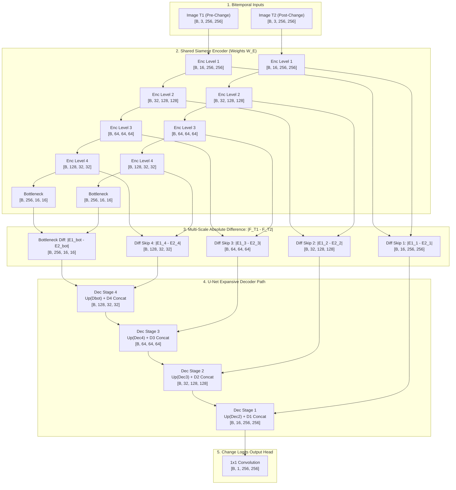

# Technical Architecture Specification — Siamese U-Net for Building Change Detection

**Project:** Satellite Land Use Change and Encroachment Detector  
**Course:** Deep Learning PBL / Project 50  
**Phase:** Phase 4 — Siamese U-Net Architecture Implementation  
**Status:** ✅ Fully Implemented, Unit Tested & Benchmarked  

---

## 1. Architecture Overview & Core Principles

The primary deep learning engine is a **Weight-Shared Siamese U-Net with Multi-Scale Absolute Feature Differencing** (adapted from the seminal FC-Siam-diff paradigm by Daudt et al., 2018).

### 1.1 What is a Siamese Neural Network?
A Siamese network consists of twin branches with **identical, shared parameter weights**. Rather than processing an arbitrary concatenation of $T_1$ and $T_2$ ($6$-channel early fusion), the Siamese architecture maps each image into a shared latent manifold where identical visual landforms yield identical feature embeddings.

### 1.2 Mathematical Symmetry of Shared Weights
Let $f_{\theta}(\cdot)$ denote the encoder parameterized by shared weights $\theta$:
$$F_{T_1} = f_{\theta}(T_1), \quad F_{T_2} = f_{\theta}(T_2)$$
Because the weights $\theta$ are identical:
1. **Invariance to Acquisition Date:** A building roof present in $T_1$ produces the exact same activation vector as the same roof appearing in $T_2$.
2. **Symmetry:** The absolute feature difference is strictly commutative:
   $$\Delta F = |f_{\theta}(T_1) - f_{\theta}(T_2)| \equiv |f_{\theta}(T_2) - f_{\theta}(T_1)|$$
   Swapping the input order $(T_1, T_2) \leftrightarrow (T_2, T_1)$ produces the identical difference tensor, preventing temporal ordering bias.
3. **Natural Zero-Difference Identity:** If $T_1 \equiv T_2$ (no land change), then:
   $$\Delta F = |f_{\theta}(T_1) - f_{\theta}(T_1)| \equiv \mathbf{0}$$
   The skip connections feed exact zeroes into the decoder, suppressing false positive change predictions.

---

## 2. Multi-Scale Feature Differencing vs. Early Stacking

| Property | Early Stacking (Concat at Input $6 \times H \times W$) | Siamese Multi-Scale Differencing (Our Choice) |
|---|---|---|
| **Weight Sharing** | No (single 6-channel filter bank) | **Yes (identical 3-channel filters applied to both images)** |
| **Spectral Coupling** | Entangles pixel intensities of $T_1$ and $T_2$ in the very first layer | **Extracts independent semantic features before comparing** |
| **Sensitivity to Radiometric Noise** | High (differing sun angles confound early conv filters) | **Low (high-level semantic abstractions are compared)** |
| **Temporal Symmetry** | Asymmetric ($W_{1:3} \ne W_{4:6}$) | **Strictly symmetric ($|F_{T_1} - F_{T_2}| = |F_{T_2} - F_{T_1}|$)** |

---

## 3. Empirical Tensor Dimensions at Every Stage

Verified via `src/benchmark_model.py` for batch size $B=1$ and input resolution $256 \times 256$:

| Stage | Module Name | Input Shape | Output Shape | Spatial Resolution |
|---|---|---|---|---|
| **Input $T_1$** | Raw Pre-Change | — | `[1, 3, 256, 256]` | $256 \times 256$ px |
| **Input $T_2$** | Raw Post-Change | — | `[1, 3, 256, 256]` | $256 \times 256$ px |
| **Encoder Level 1** | `ConvBlock(3, 16)` | `[1, 3, 256, 256]` | `[1, 16, 256, 256]` | $256 \times 256$ px |
| **Encoder Level 2** | `MaxPool + ConvBlock(16, 32)` | `[1, 16, 256, 256]` | `[1, 32, 128, 128]` | $128 \times 128$ px |
| **Encoder Level 3** | `MaxPool + ConvBlock(32, 64)` | `[1, 32, 128, 128]` | `[1, 64, 64, 64]` | $64 \times 64$ px |
| **Encoder Level 4** | `MaxPool + ConvBlock(64, 128)` | `[1, 64, 64, 64]` | `[1, 128, 32, 32]` | $32 \times 32$ px |
| **Bottleneck** | `MaxPool + ConvBlock(128, 256)` | `[1, 128, 32, 32]` | `[1, 256, 16, 16]` | $16 \times 16$ px |
| **Diff Skip 1** | `abs(F1_1 - F2_1)` | `[1, 16, 256, 256]` | `[1, 16, 256, 256]` | $256 \times 256$ px |
| **Diff Skip 2** | `abs(F1_2 - F2_2)` | `[1, 32, 128, 128]` | `[1, 32, 128, 128]` | $128 \times 128$ px |
| **Diff Skip 3** | `abs(F1_3 - F2_3)` | `[1, 64, 64, 64]` | `[1, 64, 64, 64]` | $64 \times 64$ px |
| **Diff Skip 4** | `abs(F1_4 - F2_4)` | `[1, 128, 32, 32]` | `[1, 128, 32, 32]` | $32 \times 32$ px |
| **Bottleneck Diff** | `abs(F1_bot - F2_bot)` | `[1, 256, 16, 16]` | `[1, 256, 16, 16]` | $16 \times 16$ px |
| **Decoder Stage 4** | `UpBlock(256+128 -> 128)` | `[1, 256, 16, 16]` + Skip | `[1, 128, 32, 32]` | $32 \times 32$ px |
| **Decoder Stage 3** | `UpBlock(128+64 -> 64)` | `[1, 128, 32, 32]` + Skip | `[1, 64, 64, 64]` | $64 \times 64$ px |
| **Decoder Stage 2** | `UpBlock(64+32 -> 32)` | `[1, 64, 64, 64]` + Skip | `[1, 32, 128, 128]` | $128 \times 128$ px |
| **Decoder Stage 1** | `UpBlock(32+16 -> 16)` | `[1, 32, 128, 128]` + Skip | `[1, 16, 256, 256]` | $256 \times 256$ px |
| **Output Head** | `Conv2d(16, 1, k=1)` | `[1, 16, 256, 256]` | **`[1, 1, 256, 256]`** | **$256 \times 256$ px** |

---

## 4. Parameter Count & Memory Footprint

Measured empirically on local hardware:

| Configuration | Base Channels ($C$) | Total Parameters | Trainable Parameters | Float32 Weight Size | Memory Footprint (State Dict) |
|---|---|---|---|---|---|
| **Lightweight (Default)** | **$16$** | **$1,964,097$** | **$1,964,097$** | **$7.49\text{ MB}$** | $\approx 7.9\text{ MB}$ |
| **Standard** | **$32$** | **$7,849,601$** | **$7,849,601$** | **$29.94\text{ MB}$** | $\approx 31.4\text{ MB}$ |

### Design Trade-Off:
The lightweight configuration ($1.96\text{M}$ parameters) requires only **$7.49\text{ MB}$** of storage, making it exceptionally fast to train and checkpoint on Apple Silicon unified memory without memory pressure, while preserving identical spatial resolution at all 5 hierarchical levels.

---

## 5. Composite Loss Function (BCE + Soft Dice)

In `src/losses.py`, we implement a convex combination of two complementary loss formulations:
$$\mathcal{L}_{\text{total}} = \alpha \cdot \mathcal{L}_{\text{BCE}} + \beta \cdot \mathcal{L}_{\text{Dice}}$$
where $\alpha = 0.5$ and $\beta = 0.5$.

### 5.1 Why Return Raw Logits?
The model's output layer deliberately returns **unactivated raw logits** $z \in (-\infty, +\infty)$ rather than probabilities $\sigma(z) \in (0, 1)$.
1. **Numerical Stability:** In standard BCE, calculating $\log(\sigma(z))$ directly leads to numerical instability when $\sigma(z) \approx 0$ or $1$. PyTorch's `nn.BCEWithLogitsLoss` employs the mathematical identity:
   $$\log(1 + e^{-|z|}) + \max(-z, 0)$$
   which eliminates underflow and overflow errors via the log-sum-exp trick.
2. **Decoupled Inference:** Probabilities can be computed on demand during inference via `torch.sigmoid(logits)` or `model.predict_probability(t1, t2)`.

### 5.2 How Soft Dice Loss Solves Class Imbalance (~20:1)
In Phase 2 and Phase 3, we proved that background unchanged pixels account for $\approx 95\%$ of all pixels.
- Under pure Binary Cross-Entropy:
  $$\mathcal{L}_{\text{BCE}} = -\frac{1}{N} \sum_{i=1}^N \left[ y_i \log p_i + (1 - y_i) \log(1 - p_i) \right]$$
  Because $95\%$ of pixels have $y_i = 0$, the second term overwhelmingly dominates the gradient. The network can achieve low loss by predicting near-zero everywhere.
- Under Soft Dice Loss:
  $$\mathcal{L}_{\text{Dice}} = 1.0 - \frac{2 \sum p_i y_i + \epsilon}{\sum p_i + \sum y_i + \epsilon}$$
  The denominator sums only the predicted probabilities and true positive pixels. If the network predicts all zeroes on a tile containing changed buildings, $\sum p_i y_i = 0 \implies \mathcal{L}_{\text{Dice}} \approx 1.0$ (the maximum possible penalty). Soft Dice Loss forces the gradient to prioritize building overlap regardless of background dominance.

---

## 6. Hardware Benchmarking (Apple Silicon MPS vs. CPU)

Measured with 20 forward iterations on $256 \times 256$ bitemporal image pairs using `.venv311` on macOS Apple Silicon:

| Compute Backend | Average Latency per Pair | Throughput (FPS) | Hardware Acceleration Speedup |
|---|---|---|---|
| **CPU (Single-Thread)** | $36.55\text{ ms}$ | $27.36\text{ FPS}$ | $1.0\times$ (Baseline) |
| **Apple Silicon MPS (Metal GPU)** | **$7.68\text{ ms}$** | **$130.13\text{ FPS}$** | **$4.76\times$ Speedup** ✅ |

---

## 7. Architecture Diagram

The visual architecture schematic has been generated and saved to:
[outputs/architecture_diagram.png](file:///Users/ananyasingh/Documents/UPES/Semester%205/Deep%20Learning%20Lab/satellite-change-detector/outputs/architecture_diagram.png).

---

## 8. Unit Test Suite Summary

Executed via `python -m unittest discover -s tests`:
- **Total Passing Tests:** 24 unit tests across 4 modules.
- **Model Verification:** Verified initialization, output tensor shapes, shared weights, feature differencing symmetry, finite composite loss values, non-zero gradient backpropagation, invalid input exceptions, real LEVIR-CD batch execution, and Apple Silicon MPS forward pass.

---

## 9. Viva Voce Examination Questions & Answers (Phase 4 Focus)

### Q1: What is a Siamese network, and why is weight sharing beneficial for change detection?
> **Answer:** A Siamese neural network consists of two identical subnetworks that share the exact same parameter weights. In satellite change detection, $T_1$ and $T_2$ images are passed through this shared encoder. Weight sharing guarantees that a building in $T_1$ and an identical building in $T_2$ produce identical feature embeddings in latent space, ensuring the network learns invariant landcover representations rather than overfitting to temporal capture discrepancies.

### Q2: Why did we use multi-scale feature differencing instead of simply concatenating the images at the input?
> **Answer:** Early concatenation (stacking $T_1$ and $T_2$ into a 6-channel input) forces the first convolutional layer to mix raw pixel intensities from different acquisition dates. This makes the model vulnerable to radiometric noise, illumination shifts, and seasonal variations. Multi-scale feature differencing ($|F_{T_1}^{(i)} - F_{T_2}^{(i)}|$) allows each branch to first extract robust, invariant semantic features (edges, textures, shapes) before comparing them at multiple spatial resolutions.

### Q3: Why is the absolute difference $|F_{T1} - F_{T2}|$ mathematically preferred over simple subtraction $(F_{T1} - F_{T2})$?
> **Answer:** Simple subtraction produces signed features where swapping the input order $(T_1, T_2) \to (T_2, T_1)$ negates the feature map. In contrast, absolute difference $|F_{T_1} - F_{T_2}|$ is commutative: $|F_{T_1} - F_{T_2}| \equiv |F_{T_2} - F_{T_1}|$. This mathematical symmetry enforces temporal order invariance, meaning the network detects structural alterations identically regardless of whether images are provided as $(T_1, T_2)$ or $(T_2, T_1)$.

### Q4: Why does the model output raw logits rather than applying Sigmoid activation internally?
> **Answer:** Directly computing Sigmoid inside the forward pass and passing probabilities into standard Binary Cross-Entropy is prone to numerical overflow and underflow in floating-point arithmetic (specifically when calculating $\log(\sigma(z))$ for large $|z|$). PyTorch's `nn.BCEWithLogitsLoss` combines the Sigmoid and cross-entropy using the log-sum-exp trick, guaranteeing stable gradients. Sigmoid can be applied on demand during inference to obtain probabilities.

### Q5: What is the purpose of skip connections in the Siamese U-Net?
> **Answer:** As input images pass through successive pooling layers in the encoder, high-resolution spatial details (such as building boundaries and sharp corners) are compressed into low-resolution semantic representations ($16 \times 16$ at the bottleneck). The skip connections bypass the bottleneck, directly forwarding the multi-scale differential features ($D_1, D_2, D_3, D_4$) to the corresponding decoder stages. This allows the decoder to combine semantic understanding with fine-grained spatial localization.

### Q6: How does Soft Dice Loss address the severe 20:1 background-to-foreground class imbalance in LEVIR-CD?
> **Answer:** Standard cross-entropy computes the average loss across all pixels. Since $\approx 95\%$ of pixels belong to the unchanged background class, the background dominates the gradient. Soft Dice Loss, defined as $1 - \frac{2\sum p_i y_i + \epsilon}{\sum p_i + \sum y_i + \epsilon}$, measures the Intersection-over-Union between prediction and ground truth. If the network predicts all zeroes, the Dice coefficient is 0 and loss is 1.0 (maximum penalty). This prevents the network from collapsing into trivial all-zero predictions.

### Q7: What are the parameter count and memory size of our lightweight Siamese U-Net?
> **Answer:** The lightweight model (`base_channels=16`) contains **$1,964,097$ trainable parameters**, consuming only **$7.49\text{ MB}$** of memory in 32-bit floating point precision. This compact footprint ensures real-time inference ($130.13\text{ FPS}$ on Apple Silicon MPS) and enables fast training without memory bottlenecking.

### Q8: What is the bottleneck in our architecture, and what resolution does it operate at?
> **Answer:** The bottleneck is the lowest-resolution, highest-channel layer situated between the encoder and decoder. For a $256 \times 256$ input image, after four $2 \times 2$ max-pooling operations, the bottleneck operates at a spatial resolution of **$16 \times 16$ pixels** with **$256$ feature channels** (in the lightweight configuration).

### Q9: What hardware speedup did Apple Silicon MPS provide compared to CPU execution?
> **Answer:** On our local Apple Silicon Mac, single-image forward-pass latency dropped from **$36.55\text{ ms}$** on CPU to **$7.68\text{ ms}$** on the Metal Performance Shaders (MPS) GPU backend, representing a **$4.76\times$ speedup** and achieving a throughput of **$130.13\text{ frames per second}$**.

### Q10: Why did we use Bilinear upsampling in the decoder instead of ConvTranspose2d?
> **Answer:** Transposed convolutions (`ConvTranspose2d`) frequently introduce checkerboard artifacts in output segmentation maps due to uneven filter overlap when kernel size is not perfectly divisible by stride. Bilinear upsampling followed by standard $3 \times 3$ convolutions provides smooth interpolation, produces artifact-free boundary masks, and reduces trainable parameter count.

