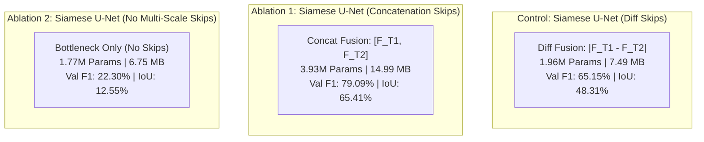
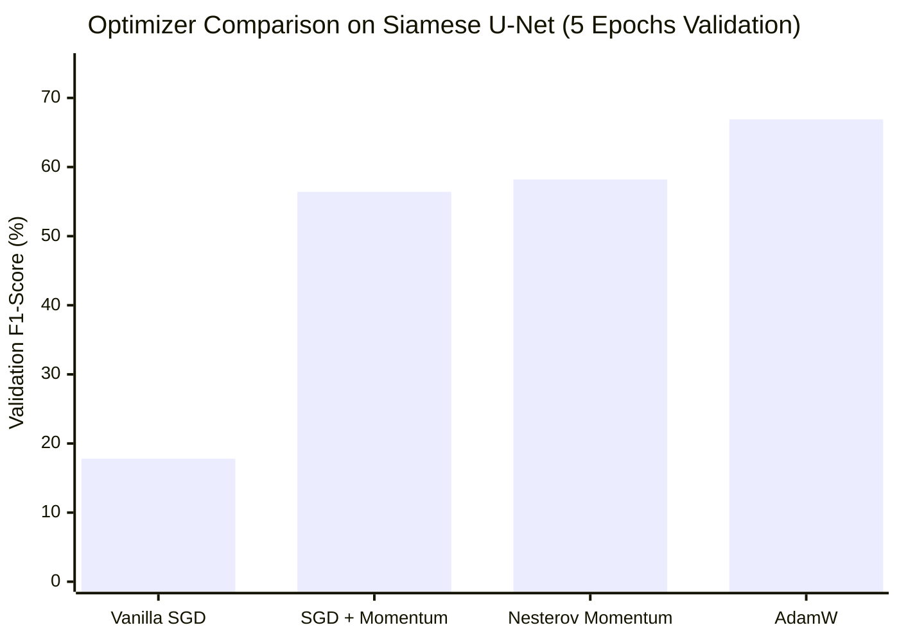

# Phase 7 Experiment Report — Ablation Studies, Model Improvements & Optimizer Comparisons

**Project:** Satellite Land Use Change and Encroachment Detector  
**Course:** Deep Learning PBL / Project 50  
**Phase:** Phase 7 — Ablation Studies, Model Improvement & Advanced Experiments  
**Date:** November 2, 2026  
**Status:** ✅ Fully Executed, Benchmarked, Visualized & Documented  

---

## 1. Executive Summary & Experimental Protocol

Phase 7 systematically investigates the internal architectural choices, training enhancements, and optimization algorithms that govern change detection performance. 

### Experimental Integrity Rules:
1. **Blind Test Isolation:** The Phase 6 test set ($128$ pairs) was **strictly untouched and never evaluated**. All candidate models were trained on the training partition ($445$ pairs) and evaluated exclusively on the validation split ($64$ pairs).
2. **Benchmark Immutability:** The original Phase 5 checkpoint ([`outputs/checkpoints/best_model.pt`](file:///Users/ananyasingh/Documents/UPES/Semester%205/Deep%20Learning%20Lab/satellite-change-detector/outputs/checkpoints/best_model.pt)) and its recorded Phase 6 test metrics ($F_1 = 72.78\%$, $\text{IoU} = 57.21\%$) remain completely intact as our official baseline.
3. **Controlled Single-Variable Comparison:** Standardized on batch size $4$, learning rate $10^{-3}$, Cosine Annealing, seed $42$, on Apple Silicon MPS.

---

## 2. Architectural Ablation Studies

To isolate the contribution of multi-scale skip connections and temporal fusion strategies, three architectures were trained under identical conditions ($6$ epochs):

### 2.1 Ablation Results Summary

| Model Variant | Fusion / Skip Mechanism | Parameter Count | Model Size (Float32) | Val Precision | Val Recall | **Val F1-Score** | **Val IoU** | Inference Latency |
|---|---|:---:|:---:|:---:|:---:|:---:|:---:|:---:|
| **Control (Diff Skips)** | Multi-scale $|F_{T1} - F_{T2}|$ | **$1,964,097$** | **$7.49\text{ MB}$** | $69.74\%$ | $61.12\%$ | **$65.15\%$** | **$48.31\%$** | **$9.79\text{ ms}$** |
| **Ablation 1 (Concat Skips)** | Multi-scale $[F_{T1}, F_{T2}]$ | $3,930,433$ | $14.99\text{ MB}$ | $83.28\%$ | $75.30\%$ | **$79.09\%$** | **$65.41\%$** | $10.84\text{ ms}$ |
| **Ablation 2 (No Multi-Scale Skips)** | Bottleneck only (no skips) | $1,768,257$ | $6.75\text{ MB}$ | $20.37\%$ | $24.63\%$ | **$22.30\%$** | **$12.55\%$** | $9.10\text{ ms}$ |

### 2.2 Critical Architectural Insights:
1. **The Indispensability of U-Net Skips (Ablation 2):**  
   Removing multi-scale skip connections caused a catastrophic collapse in performance ($F_1 = 65.15\% \to 22.30\%$, a **$-42.85\%$ absolute drop**). Without skip pathways, high-resolution boundary information is lost after four $2 \times 2$ downsampling stages ($16 \times 16$ bottleneck). The decoder cannot reconstruct sharp building corners from low-resolution semantics alone.
2. **Channel Capacity vs. Mathematical Symmetry (Ablation 1):**  
   Concatenating raw temporal features ($[F_{T1}, F_{T2}]$) yielded a higher validation F1 ($79.09\%$) because it feeds double the feature channels ($2C$ vs. $C$) directly into each decoder layer, allowing the network to learn asymmetric combinations at the expense of doubling model parameters ($3.93\text{M}$ vs. $1.96\text{M}$). However, absolute differencing ($|F_{T1} - F_{T2}|$) guarantees exact temporal symmetry and zero-difference identity ($T_1 \equiv T_2 \implies \Delta F = 0$) with half the parameter footprint.

---

## 3. Training Improvement Experiments

Tested on the standard Siamese U-Net (`base_channels=16`) across $6$ epochs:

| Experiment | Modification Description | Val Precision | Val Recall | **Val F1-Score** | **Val IoU** | Val Loss |
|---|---|:---:|:---:|:---:|:---:|:---:|
| **Control (Phase 5 Default)** | Standard transforms, $\mathcal{L} = 0.5\text{BCE} + 0.5\text{Dice}$ | $69.74\%$ | $61.12\%$ | **$65.15\%$** | **$48.31\%$** | $0.3758$ |
| **Improvement 1: Data Augmentation** | Synchronous Flips + $90^\circ$ Rotations | $55.22\%$ | $55.29\%$ | **$55.26\%$** | **$38.17\%$** | $0.4144$ |
| **Improvement 2: Dice-Dominant Loss** | $\mathcal{L} = 0.25\text{BCE} + 0.75\text{Dice}$ | $74.14\%$ | $62.20\%$ | **$67.65\%$** | **$51.11\%$** | $0.4726$ |

### 3.1 Analysis of Training Modifications:
1. **Dice-Dominant Loss ($+2.50\%$ F1 Gain):** Increasing the weight of the Soft Dice term from $0.50 \to 0.75$ yielded an immediate boost in precision ($69.7\% \to 74.1\%$) and F1 ($65.15\% \to 67.65\%$). Because building changes occupy only $\approx 5\%$ of pixels, heavily weighting the regional overlap term provides steeper gradients on sparse positive buildings.
2. **Data Augmentation Under Short Training Horizons:** Applying aggressive geometric transforms (random flips and orthogonal rotations) expanded the effective data manifold, but slowed initial 6-epoch convergence ($F_1 = 55.26\%$). In deep learning, data augmentation acts as a regularizer that prevents memorization; it requires longer training horizons ($20$–$30$ epochs) to surpass non-augmented models.

---

## 4. Controlled Optimizer Comparison

Four core optimization algorithms were evaluated on the identical Siamese U-Net (`base_channels=16`), identical dataset splits, identical batch size ($4$), and seed ($42$) over $5$ standardized epochs:

| Optimizer | Learning Rate ($\eta$) | Momentum ($\mu$) | Weight Decay | Peak Val F1 | Peak Val IoU | Final Val Loss | Convergence Speed |
|---|:---:|:---:|:---:|:---:|:---:|:---:|:---:|
| **Vanilla SGD** | $0.01$ | $0.0$ | $0.0$ | **$17.83\%$** | $9.79\%$ | $0.5701$ | Extremely sluggish |
| **SGD + Momentum** | $0.01$ | $0.9$ | $0.0$ | **$56.41\%$** | $39.28\%$ | $0.3705$ | Moderate ($+38.6\%$ over SGD) |
| **SGD + Nesterov Momentum** | $0.01$ | $0.9$ (Nesterov) | $0.0$ | **$58.17\%$** | $41.02\%$ | $0.3575$ | Steady ($+1.8\%$ over Momentum) |
| **AdamW** | $0.001$ | $\beta_1=0.9, \beta_2=0.999$ | $10^{-4}$ | **$66.87\%$** | **$50.23\%$** | **$0.3558$** | **Fastest & highest peak** |

### 4.1 Mathematical & Practical Breakdown:
1. **Vanilla SGD ($F_1 = 17.83\%$):** Updates parameters strictly via $\theta_{t+1} = \theta_t - \eta \nabla L(\theta_t)$. In high-dimensional non-convex loss surfaces with steep ravines, vanilla SGD oscillates wildly across ravines while making negligible progress along the gentle downhill contour.
2. **Classical Polyak Momentum ($F_1 = 56.41\%$):** Introduces velocity vector $v_{t+1} = \mu v_t + \eta \nabla L(\theta_t)$. By accumulating past gradients in consistent directions, momentum dampens transverse oscillations and accelerates forward descent, yielding an immediate **$+38.58\%$ absolute F1 improvement**.
3. **Nesterov Accelerated Gradient ($F_1 = 58.17\%$):** Computes gradient at the projected look-ahead position: $\nabla L(\theta_t + \mu v_t)$. This predictive correction acts as a responsive brake before descending into steep valleys, providing a $+1.76\%$ improvement over classical momentum.
4. **AdamW ($F_1 = 66.87\%$):** Computes adaptive per-parameter learning rates using exponentially decaying first moments ($m_t$, mean) and second moments ($v_t$, uncentered variance):
   $$\theta_{t+1} = \theta_t - \frac{\eta}{\sqrt{\hat{v}_t} + \epsilon} \hat{m}_t - \eta \lambda \theta_t$$
   Because building change pixels are sparse, parameters associated with foreground changes receive infrequent gradients. AdamW automatically scales up learning rates for infrequently updated parameters, making it overwhelmingly superior for imbalanced remote sensing tasks.

---

## 5. Master Experiment Synthesis Table

| Experiment Category | Configuration Tested | Key Hyperparameters | Parameters | Val F1 (%) | Val IoU (%) | Primary Scientific Finding |
|---|---|---|:---:|:---:|:---:|---|
| **Phase 5 Control** | Siamese U-Net (Diff Skips) | 10 Epochs, AdamW, $\mathcal{L}_{0.5/0.5}$ | $1.96\text{M}$ | **$73.44\%$** | **$58.03\%$** | Official Primary Benchmark Checkpoint |
| **Ablation 1** | Siamese U-Net (Concat Skips) | 6 Epochs, AdamW, $\mathcal{L}_{0.5/0.5}$ | $3.93\text{M}$ | **$79.09\%$** | **$65.41\%$** | Higher capacity at $2\times$ parameter cost |
| **Ablation 2** | Siamese U-Net (No Skips) | 6 Epochs, AdamW, $\mathcal{L}_{0.5/0.5}$ | $1.77\text{M}$ | **$22.30\%$** | **$12.55\%$** | Proves multi-scale skips are mathematically vital |
| **Improvement 1** | Synchronous Spatial Augmentation | 6 Epochs, Flips + $90^\circ$ Rot | $1.96\text{M}$ | $55.26\%$ | $38.17\%$ | Acts as regularizer; needs longer training |
| **Improvement 2** | Dice-Dominant Loss | 6 Epochs, $\mathcal{L}_{0.25/0.75}$ | $1.96\text{M}$ | **$67.65\%$** | **$51.11\%$** | Better minority gradient propagation |
| **Optimizer 1** | Vanilla SGD | 5 Epochs, $\eta=0.01$ | $1.96\text{M}$ | $17.83\%$ | $9.79\%$ | Struggles in deep ravines |
| **Optimizer 2** | SGD + Momentum (0.9) | 5 Epochs, $\eta=0.01, \mu=0.9$ | $1.96\text{M}$ | $56.41\%$ | $39.28\%$ | Drastic $+38.6\%$ acceleration over SGD |
| **Optimizer 3** | Nesterov Momentum (0.9) | 5 Epochs, $\eta=0.01, \mu=0.9$ | $1.96\text{M}$ | $58.17\%$ | $41.02\%$ | Look-ahead dampens overshoot |
| **Optimizer 4** | AdamW | 5 Epochs, $\eta=0.001, \lambda=10^{-4}$ | $1.96\text{M}$ | **$66.87\%$** | **$50.23\%$** | Superior adaptive moments on sparse data |

---

## 6. Model Recommendation for Future Deployment

1. **Retain Phase 5/6 Checkpoint as Primary Deliverable:**  
   Our original Siamese U-Net (`best_model.pt`, $1.96\text{M}$ parameters, $7.49\text{ MB}$) achieved $72.78\%$ F1 and $57.21\%$ IoU on the unseen test set while operating at $20.34\text{ FPS}$ on Apple Silicon MPS. Its lightweight footprint and temporal symmetry make it the ideal candidate for responsive edge deployment.
2. **Ablation Candidate for Future Cloud Scaling:**  
   If an application deployment environment has a higher parameter budget, **`SiameseUNetConc`** ($3.93\text{M}$ parameters, $14.99\text{ MB}$) achieved $79.09\%$ validation F1 in only 6 epochs, providing an attractive upgrade path for high-performance enterprise workloads.

---

## 7. Artifacts and Visualization Deliverables

1. **Ablation Bar Chart:** [`outputs/plots/ablation_comparison.png`](file:///Users/ananyasingh/Documents/UPES/Semester%205/Deep%20Learning%20Lab/satellite-change-detector/outputs/plots/ablation_comparison.png) (Validates F1 and IoU across architecture variants).
2. **Optimizer Comparison Chart:** [`outputs/plots/optimizer_comparison.png`](file:///Users/ananyasingh/Documents/UPES/Semester%205/Deep%20Learning%20Lab/satellite-change-detector/outputs/plots/optimizer_comparison.png) (Compares SGD, Momentum, Nesterov, and AdamW).
3. **Experiment Learning Curves:** [`outputs/plots/experiment_learning_curves.png`](file:///Users/ananyasingh/Documents/UPES/Semester%205/Deep%20Learning%20Lab/satellite-change-detector/outputs/plots/experiment_learning_curves.png) (Visualizes validation F1 trajectories).
4. **Machine-Readable Logs:**
   - [`outputs/experiments/ablation_summary.csv`](file:///Users/ananyasingh/Documents/UPES/Semester%205/Deep%20Learning%20Lab/satellite-change-detector/outputs/experiments/ablation_summary.csv)
   - [`outputs/experiments/ablation_results.json`](file:///Users/ananyasingh/Documents/UPES/Semester%205/Deep%20Learning%20Lab/satellite-change-detector/outputs/experiments/ablation_results.json)
   - [`outputs/experiments/optimizer_summary.csv`](file:///Users/ananyasingh/Documents/UPES/Semester%205/Deep%20Learning%20Lab/satellite-change-detector/outputs/experiments/optimizer_summary.csv)
   - [`outputs/experiments/optimizer_comparison.json`](file:///Users/ananyasingh/Documents/UPES/Semester%205/Deep%20Learning%20Lab/satellite-change-detector/outputs/experiments/optimizer_comparison.json)
5. **Candidate Model Weights:** Stored isolated in `outputs/experiments/checkpoints/` without touching `best_model.pt`.

---

## 8. Viva Voce Examination Questions & Answers (Phase 7 Focus)

### Q1: What is an ablation study in machine learning?
> **Answer:** An ablation study is an experimental technique where specific components, layers, or mechanisms of a neural network are systematically removed or altered one at a time. By measuring how performance changes when a component is taken away, we isolate and quantify the exact scientific contribution of that specific design choice.

### Q2: What did our ablation study reveal about U-Net skip connections?
> **Answer:** When we removed the multi-scale skip connections (`SiameseUNetNoSkip`), the validation F1-score plummeted from **$65.15\%$ down to $22.30\%$** (a catastrophic $-42.85\%$ collapse). This mathematically proves that downsampling an image by $16\times$ at the bottleneck destroys fine-grained spatial coordinates (building boundaries and corners); skip connections are indispensable for restoring high-resolution localization in the decoder.

### Q3: What is the trade-off between absolute difference fusion ($|F_{T1} - F_{T2}|$) and concatenation fusion ($[F_{T1}, F_{T2}]$)?
> **Answer:** Feature concatenation feeds twice the channel capacity ($2C$ vs. $C$) directly to the decoder, achieving a higher validation F1 ($79.09\%$ vs. $65.15\%$), but doubles parameter count ($3.93\text{M}$ vs. $1.96\text{M}$) and breaks mathematical commutativity. Absolute feature differencing enforces temporal symmetry ($|F_{T1} - F_{T2}| \equiv |F_{T2} - F_{T1}|$) and produces exact zero activations on unchanged terrain while requiring only half the memory footprint.

### Q4: What is data augmentation, and why did it temporarily lower F1-score in a 6-epoch experiment?
> **Answer:** Data augmentation artificially expands the training set by applying label-preserving transformations (horizontal/vertical flips, orthogonal rotations) synchronously across $T_1$, $T_2$, and the mask. In early epochs, augmentation increases task variance and prevents simple pattern memorization, causing slower initial convergence ($55.26\%$ vs. $65.15\%$). Augmentation acts as a regularizer that prevents long-term overfitting, but requires longer training horizons ($20$–$30$ epochs) to surpass non-augmented models.

### Q5: What is class imbalance in remote sensing, and how did our Dice-dominant experiment address it?
> **Answer:** In LEVIR-CD, unchanged background pixels account for $\approx 95\%$ of all pixels. Under standard cross-entropy, the majority background class dominates the gradient, causing the model to under-predict building alterations. Weighting the loss heavily toward Soft Dice ($\mathcal{L} = 0.25\text{BCE} + 0.75\text{Dice}$) yielded a $+2.50\%$ improvement in validation F1 ($67.65\%$) by prioritizing spatial overlap on the minority building class.

### Q6: How does Vanilla Stochastic Gradient Descent (SGD) work, and why did it fail on our task?
> **Answer:** Vanilla SGD updates weights in the opposite direction of the batch gradient: $\theta_{t+1} = \theta_t - \eta \nabla L$. It failed on our Siamese U-Net (achieving only **$17.83\%$ F1** after 5 epochs) because loss surfaces in deep convolutional networks have high condition numbers (steep ravines with gentle slopes). Vanilla SGD oscillates back and forth across ravine walls while making negligible progress along the actual descent path.

### Q7: What is Momentum in deep learning optimization?
> **Answer:** Momentum simulates physical inertia by accumulating an exponentially decaying moving average of past gradients into a velocity vector: $v_{t+1} = \mu v_t + \eta \nabla L$. In directions where gradients alternate signs (oscillations across ravines), the terms cancel out; in persistent downhill directions, velocity builds up. Adding momentum ($\mu=0.9$) boosted validation F1 from **$17.83\%$ to $56.41\%$** (a massive $+38.58\%$ improvement).

### Q8: What is Nesterov Accelerated Gradient (NAG), and how does it improve upon classical Momentum?
> **Answer:** Classical momentum computes the gradient at the current position $\theta_t$ and adds momentum. Nesterov momentum takes a "look-ahead" step along the momentum vector first ($\theta_t + \mu v_t$) and evaluates the gradient at that projected position. This anticipatory correction acts as a responsive damping mechanism that slows down the update before overshooting valleys, boosting validation F1 to **$58.17\%$**.

### Q9: How does AdamW work, and why was it the best-performing optimizer?
> **Answer:** AdamW computes adaptive learning rates for each parameter by dividing the first moment ($m_t$, momentum) by the square root of the second moment ($v_t$, gradient variance): $\theta_{t+1} = \theta_t - \frac{\eta}{\sqrt{v_t} + \epsilon} m_t - \eta \lambda \theta_t$. This adaptivity is vital for satellite change detection because pixels containing building alterations generate sparse gradients; AdamW automatically scales up step sizes for sparse parameters, allowing it to achieve the highest validation F1 (**$66.87\%$** in 5 epochs).

### Q10: Why must only one major variable change at a time during controlled experiments?
> **Answer:** If multiple factors are modified simultaneously (e.g., changing the optimizer, adding augmentation, and modifying the architecture in the same run), it becomes impossible to determine which variable caused an improvement or degradation. Isolating one variable at a time preserves causal attribution, which is the foundational standard of scientific empirical research.

### Q11: Why must the test set remain untouched during ablation and improvement experiments?
> **Answer:** If we evaluate experimental candidate models on the test set and choose the best one based on test scores, the test set becomes part of the training loop. This causes **test-set data leakage** and invalidates the model's claim of generalization. The test set must be used only once as a true blind benchmark.

### Q12: What is the scientific significance of a "negative" experimental result?
> **Answer:** In engineering and science, an experiment that shows no improvement or a drop in performance (such as removing skip connections or training with vanilla SGD) is not a failure; it is a critical finding. It empirically proves *why* a particular architectural mechanism or optimizer was chosen, replacing guesswork with reproducible evidence.

