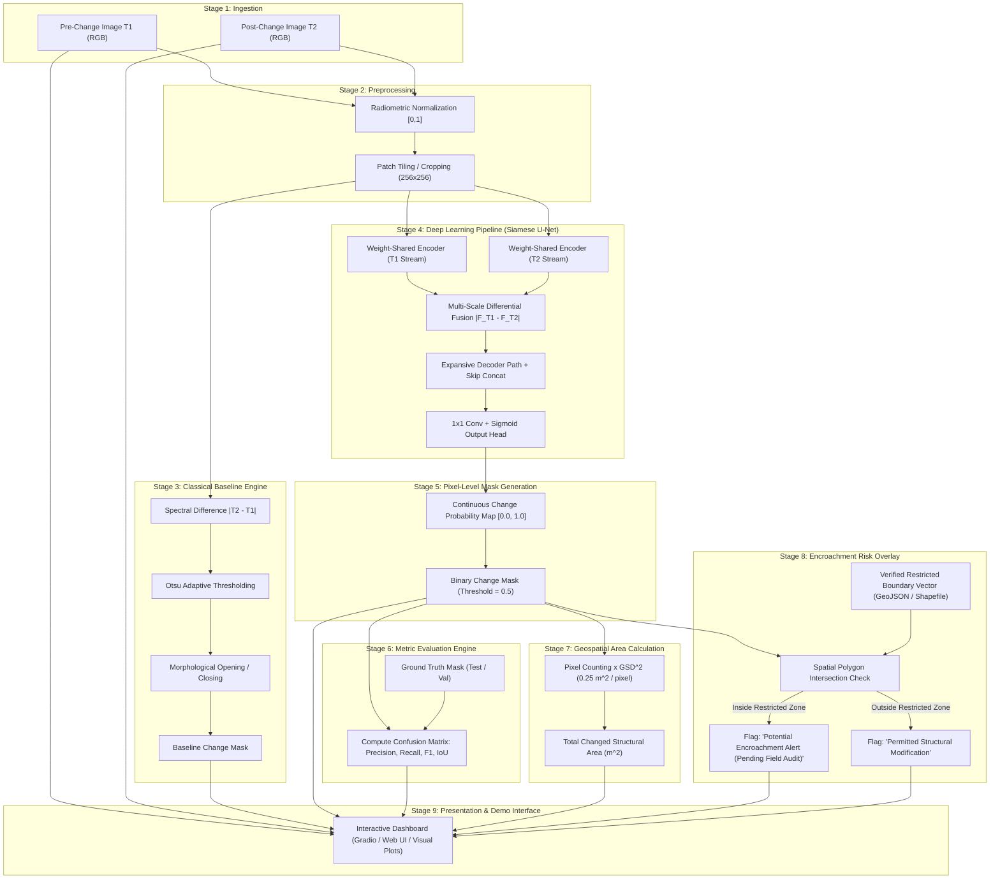

# Proposed System Architecture — Satellite Land Use Change and Encroachment Detector

**Project Title:** Satellite Land Use Change and Encroachment Detector  
**Course:** Deep Learning — Project-Based Learning (PBL) / Project 50  
**Phase:** Phase 1 — Technical System Design  

---

## 1. End-to-End System Workflow

The proposed application follows a modular, pipelined dataflow architecture structured into nine distinct stages:



---

## 2. Deep Learning Model Architecture: Siamese U-Net

The core neural network model is an adapted **Siamese U-Net**, designed specifically for bitemporal satellite change detection.

```
                  Image T1 (3 x 256 x 256)           Image T2 (3 x 256 x 256)
                            |                                  |
                            v                                  v
             +------------------------------+   +------------------------------+
  Level 1    |  Encoder Block 1 (Shared W)  |   |  Encoder Block 1 (Shared W)  |
             +------------------------------+   +------------------------------+
                   |                 |                |                 |
                   | Feature F1_1    +--------+-------+                 | Feature F2_1
                   |                          |                         |
                   v                          v Diff 1                  v
             +------------------------------+ | [ |F1_1 - F2_1| ] +-----+------------------------+
  Level 2    |  Encoder Block 2 (Shared W)  | |                   |  Encoder Block 2 (Shared W)  |
             +------------------------------+ |                   +------------------------------+
                   |                 |        |                         |                 |
                   | Feature F1_2    +--------+-------+                 | Feature F2_2    |
                   |                          |                         |                 |
                   v                          v Diff 2                  v                 |
             +------------------------------+ | [ |F1_2 - F2_2| ] +-----+-----------------+------+
  Level 3    |  Encoder Block 3 (Shared W)  | |                   |  Encoder Block 3 (Shared W)  |
             +------------------------------+ |                   +------------------------------+
                   |                 |        |                         |                 |
                   | Feature F1_3    +--------+-------+                 | Feature F2_3    |
                   |                          |                         |                 |
                   v                          v Diff 3                  v                 |
             +------------------------------+ | [ |F1_3 - F2_3| ] +-----+-----------------+------+
  Level 4    |  Encoder Block 4 (Shared W)  | |                   |  Encoder Block 4 (Shared W)  |
             +------------------------------+ |                   +------------------------------+
                   |                          |                         |
                   v                          v Diff 4 (Bottleneck)     v
                   +------------------------> | [ |F1_4 - F2_4| ] <-----+
                                              +--------+--------+
                                                       |
                                                       v
                                            +---------------------+
                                 Level 4    |  Decoder Block 4    |
                                            +---------------------+
                                                       |
                                            +----------+----------+ (Upsample + Skip Concat Diff 3)
                                                       v
                                            +---------------------+
                                 Level 3    |  Decoder Block 3    |
                                            +---------------------+
                                                       |
                                            +----------+----------+ (Upsample + Skip Concat Diff 2)
                                                       v
                                            +---------------------+
                                 Level 2    |  Decoder Block 2    |
                                            +---------------------+
                                                       |
                                            +----------+----------+ (Upsample + Skip Concat Diff 1)
                                                       v
                                            +---------------------+
                                 Level 1    |  Decoder Block 1    |
                                            +---------------------+
                                                       |
                                                       v
                                            +---------------------+
                                            |  1x1 Conv + Sigmoid |
                                            +---------------------+
                                                       |
                                                       v
                                            Binary Change Probability Mask
                                                 (1 x 256 x 256)
```

---

## 3. Detailed Component Breakdown

### 3.1 Dual-Branch Weight-Shared Siamese Encoder
- **Structure:** Two parallel encoder streams share identical convolutional weights ($W_{E_1} \equiv W_{E_2}$).
- **Functionality:** Ingests $I_{T_1}$ and $I_{T_2}$ separately. Weight sharing ensures that identical visual patterns (e.g., roof tiles, concrete textures) map to identical latent embedding vectors regardless of temporal acquisition date.
- **Stages:** 4 downsampling stages, each comprising dual $3 \times 3$ Conv-BatchNorm-ReLU layers followed by $2 \times 2$ MaxPool operations. Channel dimensions: $3 \to 32 \to 64 \to 128 \to 256$.

### 3.2 Multi-Scale Differential Skip Fusion
- **Mechanism:** At each spatial resolution level $l \in \{1, 2, 3, 4\}$, the model computes the absolute temporal difference tensor:
  $$\Delta F^{(l)} = |F_{T_1}^{(l)} - F_{T_2}^{(l)}|$$
- **Advantage over Simple Channel Stacking:** Direct feature subtraction enforces zero activation when land features remain unchanged ($F_{T_1} \approx F_{T_2} \implies \Delta F \approx 0$), while strongly activating when structural transitions occur.

### 3.3 Expansive Decoder Path
- **Structure:** 4 upsampling stages using Bilinear Interpolation or Transposed Convolution ($2 \times 2$, stride $2$), followed by concatenation with the corresponding multi-scale skip differential tensor $\Delta F^{(l)}$.
- **Refinement:** Dual $3 \times 3$ Conv-BatchNorm-ReLU blocks merge high-level semantic context with precise low-level boundary localization. Channel dimensions: $256 \to 128 \to 64 \to 32 \to 16$.

### 3.4 Output Classification Head
- **Layer:** $1 \times 1$ Convolution reducing feature depth from $16 \to 1$, followed by a `Sigmoid` activation function.
- **Output:** Continuous probability raster $\hat{Y} \in [0.0, 1.0]^{H \times W}$.
- **Decision Rule:** Binarized via an adjustable decision threshold $\tau$ (default $\tau = 0.50$):
  $$M(x, y) = \begin{cases} 1, & \text{if } \hat{Y}(x, y) \ge \tau \\ 0, & \text{otherwise} \end{cases}$$

---

## 4. Loss Function Formulation: Composite BCE + Dice Loss

To overcome severe foreground-background class imbalance (where changed building pixels comprise $< 15\%$ of total image area), we employ a hybrid loss function:

$$\mathcal{L}_{\text{total}} = \alpha \mathcal{L}_{\text{BCE}} + (1 - \alpha) \mathcal{L}_{\text{Dice}}$$

Where:
1. **Weighted Binary Cross-Entropy ($\mathcal{L}_{\text{BCE}}$):**
   $$\mathcal{L}_{\text{BCE}} = -\frac{1}{N} \sum_{i=1}^N \left[ y_i \log(\hat{y}_i) + (1 - y_i) \log(1 - \hat{y}_i) \right]$$
   Provides stable, smooth gradient descent during early training phases.

2. **Soft Dice Loss ($\mathcal{L}_{\text{Dice}}$):**
   $$\mathcal{L}_{\text{Dice}} = 1 - \frac{2 \sum_{i=1}^N y_i \hat{y}_i + \epsilon}{\sum_{i=1}^N y_i + \sum_{i=1}^N \hat{y}_i + \epsilon}$$
   Directly optimizes for spatial mask overlap and is invariant to class imbalance.

*(Default parameter: $\alpha = 0.50$, smoothing factor $\epsilon = 10^{-6}$)*.

---

## 5. Geospatial and Encroachment Subsystem

### 5.1 Area Quantification Engine
Using the known sensor Ground Sampling Distance ($\text{GSD} = 0.5\text{ meters}$ per pixel on LEVIR-CD):
$$\text{Pixel Area} = 0.5\text{ m} \times 0.5\text{ m} = 0.25\text{ m}^2$$
$$\text{Total Altered Footprint } (\text{m}^2) = \left( \sum_{x, y} M(x, y) \right) \times 0.25$$

### 5.2 Vector Boundary Cross-Referencing
- Ingests vector boundary polygons (GeoJSON / ESRI Shapefile) demarcating restricted zones (e.g., protected wetlands, forest reserves, public utility buffers).
- Computes boolean geometric intersection between the predicted binary mask raster (vectorized to polygons via OpenCV contour extraction) and the restricted zone polygon:
  $$\text{Encroachment Alert Area} = \text{Detected Change Polygons} \cap \text{Restricted Zone Polygons}$$
- Generates a geo-referenced alert map highlighting candidate non-compliant structural footprints in high-visibility warning overlays (e.g., red polygon boundary over contemporary satellite image $T_2$).

