# Blind Test Evaluation & Comparative Benchmarking Report

**Project:** Satellite Land Use Change and Encroachment Detector  
**Course:** Deep Learning PBL / Project 50  
**Phase:** Phase 6 — Final Testing, Benchmarking & Evaluation  
**Date:** November 2, 2026  
**Status:** ✅ Fully Evaluated, Benchmarked, Visualized & Documented  

---

## 1. Executive Summary

In Phase 6, the optimal **Siamese U-Net** model (checkpoint from Epoch 9, $1.96\text{M}$ parameters) was evaluated **exactly once** on the unseen, blind **LEVIR-CD test set** (128 bitemporal image pairs, $8,388,608$ total pixels) using the locked operational threshold **$\tau^* = 0.20$**.

### Definitive Test Benchmark Results:
- **Precision:** **$0.7760$ ($77.60\%$)**
- **Recall:** **$0.6853$ ($68.53\%$)**
- **F1-Score:** **$0.7278$ ($72.78\%$)**
- **Intersection over Union (IoU):** **$0.5721$ ($57.21\%$)**
- **Pixel Accuracy:** **$0.9739$ ($97.39\%$)**
- **Specificity:** **$0.9894$ ($98.94\%$)**
- **Test Composite Loss:** **$0.2913$** (BCE: $0.0903$, Soft Dice: $0.4923$)
- **Confusion Matrix:** $\text{TP} = 292,915 \mid \text{FP} = 84,550 \mid \text{FN} = 134,499 \mid \text{TN} = 7,876,644$.

### Validation vs. Blind Test Generalization:
The blind test metrics closely mirror the validation metrics ($\Delta F_1 = 0.66\%$, $\Delta \text{IoU} = 0.82\%$), proving that the Siamese U-Net generalizes to unseen geographic terrain without overfitting:
- **Validation:** $F_1 = 73.44\%$, $\text{IoU} = 58.03\%$, $\text{Loss} = 0.2996$
- **Blind Test:** $F_1 = \mathbf{72.78\%}$, $\text{IoU} = \mathbf{57.21\%}$, $\text{Loss} = \mathbf{0.2913}$

---

## 2. Experimental Rigor & Anti-Leakage Protocol

1. **Blind Test Integrity:** The test dataset was completely withheld during Phase 0 through Phase 5. No threshold tuning, hyperparameter search, or architecture adjustments were made using test data.
2. **Fixed Operational Threshold:** The threshold $\tau^* = 0.20$ was derived on the 64 validation pairs during Phase 5 and applied directly to the test set without adjustment.
3. **Single Evaluation Pass:** The model was evaluated once through `src/evaluate.py`. No cherry-picking or multi-run averaging was conducted.

---

## 3. Comparative Benchmarking: Siamese U-Net vs. Traditional Baseline

Both methods were evaluated on the **exact same 128 test pairs** ($8,388,608$ pixels) at their respective validation-selected thresholds ($\tau = 0.40$ for Baseline, $\tau^* = 0.20$ for Siamese U-Net):

| Evaluation Metric | Phase 3 Traditional Baseline ($\tau=0.40$) | Phase 6 Siamese U-Net ($\tau^*=0.20$) | Absolute Improvement | Relative Multiplier |
|---|:---:|:---:|:---:|:---:|
| **Precision** | $14.08\%$ | **$77.60\%$** | **$+63.52\%$** | **$5.51\times$ higher** |
| **Recall** | $13.88\%$ | **$68.53\%$** | **$+54.66\%$** | **$4.94\times$ higher** |
| **F1-Score** | $13.98\%$ | **$72.78\%$** | **$+58.81\%$** | **$5.21\times$ higher** |
| **Intersection over Union (IoU)** | $7.51\%$ | **$57.21\%$** | **$+49.70\%$** | **$7.62\times$ higher** |
| **Pixel Accuracy** | $91.30\%$ | **$97.39\%$** | **$+6.09\%$** | $1.07\times$ |
| **False Positives (FP)** | $362,021$ | **$84,550$** | **$-277,471$** | **$76.6\%$ reduction** |
| **False Negatives (FN)** | $368,106$ | **$134,499$** | **$-233,607$** | **$63.5\%$ reduction** |

```mermaid
xychart-beta
    title "Blind Test Set Performance Comparison (LEVIR-CD, 128 Pairs)"
    x-axis ["Precision (%)", "Recall (%)", "F1-Score (%)", "IoU (%)", "Pixel Accuracy (%)"]
    y-axis "Percentage" 0 --> 100
    bar [14.1, 13.9, 14.0, 7.5, 91.3]
    bar [77.6, 68.5, 72.8, 57.2, 97.4]
```



### Critical Takeaway:
The classical baseline failed because it cannot differentiate between spectral noise (sun shadows, grass seasonal shifts) and structural changes, generating $362,021$ false alarms. The Siamese U-Net slashed false alarms by **$76.6\%$** and missed detections by **$63.5\%$**, elevating IoU from **$7.51\%$ to $57.21\%$**.

---

## 4. Qualitative Visual Analysis & Error Overlays

High-resolution 6-panel diagnostic comparisons were generated in [`outputs/test_predictions/`](file:///Users/ananyasingh/Documents/UPES/Semester%205/Deep%20Learning%20Lab/satellite-change-detector/outputs/test_predictions/):
- **Panel 1:** Pre-Change Image ($T_1$)
- **Panel 2:** Post-Change Image ($T_2$)
- **Panel 3:** Ground Truth Mask
- **Panel 4:** Traditional Baseline Prediction ($\tau = 0.40$)
- **Panel 5:** Siamese U-Net Prediction ($\tau^* = 0.20$)
- **Panel 6:** Error Diagnostic Overlay:
  - **Green:** True Positives (Correct Detections)
  - **Red:** False Positives (False Alarms)
  - **Blue:** False Negatives (Missed Alterations)

### Representative Diagnostic Cases:
1. **Large Residential Complex Expansion (`test_1.png`):**  
   - *Observation:* Multiple residential homes built on prior vegetation.
   - *Result:* Siamese U-Net achieves clean rectangular footprints with crisp boundaries. The baseline produces fragmented noise across the surrounding terrain.
2. **Dense Seasonal Grass Discoloration (`test_108.png`):**  
   - *Observation:* Severe seasonal parching where pasture land turns from bright green to dry yellow.
   - *Result:* Baseline triggers massive false positive clusters across the entire pasture. Siamese U-Net correctly suppresses the agricultural background, segmenting only genuine building structures.
3. **Elongated Tree and Building Shadows (`test_119.png`):**  
   - *Observation:* Solar angle differences cast long shadows across building edges.
   - *Result:* Baseline mistakes shadow borders for new construction. Siamese U-Net semantic features are invariant to illumination gradients.
4. **Subtle Low-Contrast Building Construction (`test_15.png`):**  
   - *Observation:* Pale gray concrete rooftop constructed on light limestone soil.
   - *Result:* Baseline completely misses the construction ($FN$). Siamese U-Net recognizes spatial geometric regularity and segments the structure.
5. **Challenging Small Sheds / False Negatives (`test_27.png`, `test_4.png`):**  
   - *Observation:* Very small detached outbuildings ($< 25\text{ m}^2$).
   - *Failure Mode:* Due to downsampling from $1024 \times 1024$ to $256 \times 256$, small structures occupy only $1$–$2$ pixels and are occasionally missed by the decoder.

---

## 5. Detailed Error Analysis

### 5.1 Success Patterns:
- **Sharp Geometric Boundaries:** The U-Net skip connections successfully preserve 90-degree corners and flat rooftop geometries.
- **Vegetation Invariance:** Shared convolutional weights filter out chlorophyll reflectance shifts, eliminating seasonal false positives.

### 5.2 Failure Patterns & Residual Errors:
1. **Paved Driveways and Foundations ($FP$):** Paved asphalt driveways accompanying new homes sometimes exhibit spectral textures similar to dark flat roofs, causing minor edge bleeding ($84,550$ total false positive pixels).
2. **Sub-Pixel Spatial Loss ($FN$):** Resizing $1024 \times 1024$ images down to $256 \times 256$ causes fine structural details to collapse. Single-car garages and sheds under $25\text{ m}^2$ represent the majority of the $134,499$ false negative pixels.
3. **Severe Off-Nadir Viewing Angles:** A building observed at off-nadir tilt in $T_2$ shows visible wall facades that were occluded in $T_1$, leading to boundary dilation.

---

## 6. Runtime, Throughput & Hardware Benchmarks

Measured on the 128 test pairs ($8,388,608$ pixels) using `.venv311` on macOS Apple Silicon:

| Metric | Measured Value |
|---|---|
| **Hardware Compute Device** | Apple Silicon Metal Performance Shaders (`mps`) |
| **Total Test Inference Time** | **$6.294\text{ seconds}$** (128 pairs) |
| **Average Latency per Pair** | **$49.17\text{ ms per pair}$** |
| **Inference Throughput** | **$20.34\text{ frames per second (FPS)}$** |
| **Trainable Parameters** | $1,964,097$ parameters |
| **Serialized Checkpoint Size** | $22.57\text{ MB}$ (includes model + AdamW optimizer state) |
| **Weight-Only Memory Size** | $7.49\text{ MB}$ (float32 parameters) |
| **Host Disk Free Space** | **$7.9\text{ GiB}$ remaining** |

---

## 7. Geospatial Scaling & Physical Area Calculation

### 7.1 Mathematical Resolution Scaling
In the original LEVIR-CD benchmark:
- Original Dimensions: $1024 \times 1024\text{ pixels}$
- Ground Sampling Distance (GSD): $0.50\text{ meters per pixel}$
- Physical Area per Pixel: $(0.50\text{ m})^2 = 0.25\text{ m}^2$

In our preprocessing pipeline, images were resized to $256 \times 256\text{ pixels}$ (a scale factor of $4$ in both spatial dimensions):
$$\text{Effective GSD} = 0.50\text{ m} \times \left(\frac{1024}{256}\right) = 2.00\text{ meters per pixel}$$
$$\text{Physical Area per Model Pixel} = (2.00\text{ m})^2 = \mathbf{4.00\text{ m}^2\text{ per pixel}}$$

### 7.2 Empirical Test Set Area Measurements:
- **Ground Truth Changed Pixels:** $427,414\text{ pixels}$
  $$\text{Ground Truth Altered Area} = 427,414 \times 4.00\text{ m}^2 = \mathbf{1,709,656\text{ m}^2}\text{ ($170.97\text{ hectares}$)}$$
- **Model Predicted Changed Pixels:** $377,465\text{ pixels}$
  $$\text{Predicted Altered Area} = 377,465 \times 4.00\text{ m}^2 = \mathbf{1,509,860\text{ m}^2}\text{ ($150.99\text{ hectares}$)}$$
- **Area Estimation Error:** The model estimated within **$88.3\%$** of the actual physical area, with slight undercounting due to small structure edge erosion ($FN > FP$).

---

## 8. Responsible AI & The Legal Boundary of Encroachment

> [!IMPORTANT]
> **Defensible Boundary & Ethical Standard:**
> 1. **No Embedded Georeferencing in Standard PNGs:** The LEVIR-CD benchmark is distributed as standard raster `.png` files without embedded GeoTIFF tags, spatial reference systems (CRS/EPSG codes), or affine transformation world files. Absolute geographic coordinates cannot be calculated without external cadastral survey alignment.
> 2. **Change Detection $\ne$ Illegal Encroachment:** A detected pixel alteration represents a visual morphological change (e.g., building erection or extension). **A computer vision model cannot determine legal authorization.** Permitted private development, municipal infrastructure, and unauthorized encroachment look identical to an optical sensor.
> 3. **Ethical System Role:** The system operates strictly as an **advisory decision-support tool** for prioritizing on-site physical audits when cross-referenced against authenticated restricted boundary vector layers (e.g., national parks, public rights-of-way, coastal buffer zones).

---

## 9. Reproducibility Instructions

To reproduce the exact blind test evaluation from terminal in one command:
```bash
cd "Documents/UPES/Semester 5/Deep Learning Lab/satellite-change-detector"
source activate.sh
python src/evaluate.py
```

---

## 10. Viva Voce Examination Questions & Answers (Phase 6 Focus)

### Q1: What were the final blind test results of our Siamese U-Net, and how do they compare with the validation results?
> **Answer:** On the 128 unseen test pairs, the model achieved:
> - **Precision:** $77.60\%$
> - **Recall:** $68.53\%$
> - **F1-Score:** $72.78\%$
> - **IoU:** $57.21\%$
> - **Pixel Accuracy:** $97.39\%$
> These results closely align with our validation set performance ($F_1 = 73.44\%$, $\text{IoU} = 58.03\%$), differing by less than $0.8\%$. This confirms that our validation threshold selection ($\tau^* = 0.20$) generalized to unseen geographic regions without data leakage or overfitting.

### Q2: Why is the comparison against the traditional baseline scientifically important?
> **Answer:** Deep learning projects must empirically prove that a complex neural network is necessary. Our Phase 3 pixel-difference baseline achieved an F1-score of only $13.98\%$ and an IoU of $7.51\%$ on the same test set. Siamese U-Net achieved $72.78\%$ F1 and $57.21\%$ IoU—a **$5.2\times$ increase in F1-score and $7.6\times$ increase in IoU**. This directly demonstrates that learned convolutional abstractions are required to reject seasonal environmental noise and solar shadow artifacts.

### Q3: Why is pixel accuracy (97.39%) a misleading metric for evaluating change detection?
> **Answer:** In LEVIR-CD, unchanged background pixels account for $\approx 95\%$ of all pixels. If an algorithm simply predicts "no change" for every single pixel, it trivially achieves $95\%$ accuracy while detecting zero buildings. In fact, our traditional baseline scored $91.30\%$ pixel accuracy while being practically useless ($F_1 = 13.98\%$). In contrast, F1-score ($72.78\%$) and IoU ($57.21\%$) evaluate true positive overlap on the minority foreground class, providing the only honest measure of segmentation performance.

### Q4: What is data leakage, and how did we prevent it?
> **Answer:** Data leakage occurs when information from the test dataset influences training, hyperparameter tuning, or decision threshold selection. We prevented leakage by strictly isolating the 128 test pairs until Phase 6. All model training was conducted exclusively on the 445 training pairs, and the optimal decision threshold ($\tau^* = 0.20$) was tuned exclusively on the 64 validation pairs. The test set was evaluated once in Phase 6.

### Q5: What is the physical meaning of Intersection-over-Union (IoU) in change detection?
> **Answer:** IoU (also known as the Jaccard Index) is calculated as:
> $$\text{IoU} = \frac{\text{Area of Overlap}}{\text{Area of Union}} = \frac{TP}{TP + FP + FN}$$
> It measures the percentage of spatial overlap between the predicted change polygon and the ground-truth change polygon. An IoU of $57.21\%$ means that nearly two-thirds of the union between predicted and actual changed buildings represents exact pixel-level agreement.

### Q6: How does spatial downsampling from 1024x1024 to 256x256 affect physical ground resolution and error rates?
> **Answer:** In the original LEVIR-CD imagery ($1024 \times 1024$), Ground Sampling Distance (GSD) is $0.5\text{ m/pixel}$, meaning each pixel covers $0.25\text{ m}^2$. Downsampling by a factor of 4 to $256 \times 256$ increases effective GSD to $2.0\text{ m/pixel}$, meaning each pixel covers $(2.0\text{ m})^2 = 4.0\text{ m}^2$. This downsampling makes very small structures (like sheds or single-car garages under $25\text{ m}^2$) occupy only 2–4 pixels, making them susceptible to edge erosion and causing false negatives.

### Q7: Why did we calibrate the decision threshold to 0.20 instead of 0.50?
> **Answer:** Due to class imbalance, the model outputs slightly conservative probability values ($0.20$–$0.45$) along building edges and partially shadowed roofs. The default threshold of $0.50$ achieved high precision ($81.1\%$) but discarded true building boundary pixels ($64.5\%$ recall). Tuning the threshold to $\tau^* = 0.20$ allowed the model to capture building boundaries, raising recall to $68.53\%$ and optimizing overall F1-score to $72.78\%$.

### Q8: What are the primary failure modes of the Siamese U-Net observed in the error overlays?
> **Answer:** The primary failure modes are:
> 1. **Paved driveway/foundation false alarms ($FP$):** Concrete or asphalt foundations prepared for new construction have identical spectral properties to flat roofs.
> 2. **Small detached outbuilding misses ($FN$):** Tiny structures suffer from sub-pixel resolution loss after resizing.
> 3. **Off-nadir perspective tilt:** Steep camera viewing angles reveal wall facades in $T_2$ that were hidden in $T_1$, slightly dilating predicted building contours.

### Q9: Can our model alone legally prove unauthorized land encroachment?
> **Answer:** **No, absolutely not.** A computer vision model detects visual land alterations, not legal authorizations. Legal building permits, government construction, and unauthorized encroachment appear identical in satellite imagery. Determining illegal encroachment requires two external components: (1) verified cadastral boundary data (e.g., forest reserves, public easements), and (2) human verification by municipal survey authorities.

### Q10: What is the difference between Precision and Recall in our project?
> **Answer:** Precision ($77.60\%$) measures the reliability of detected changes: of all pixels flagged as building alterations, $77.60\%$ were genuine buildings. Recall ($68.53\%$) measures completeness: of all actual building alterations that occurred, the model discovered $68.53\%$. High precision prevents wasting municipal resources on false alarms, while adequate recall ensures significant new constructions are not overlooked.

### Q11: What is the confusion matrix breakdown on the test set?
> **Answer:** Across $8,388,608$ test pixels:
> - **True Positives (TP):** $292,915\text{ pixels}$ (correctly segmented building changes).
> - **False Positives (FP):** $84,550\text{ pixels}$ (false alarms from driveways or soil).
> - **False Negatives (FN):** $134,499\text{ pixels}$ (missed building parts or small sheds).
> - **True Negatives (TN):** $7,876,644\text{ pixels}$ (correctly identified unchanged background).

### Q12: How fast is inference on our Mac hardware, and is it suitable for operational use?
> **Answer:** Inference runs at **$49.17\text{ ms per pair}$** (**$20.34\text{ FPS}$**) on Apple Silicon Metal Performance Shaders (MPS). Evaluating an entire regional surveillance tile ($128$ image pairs) took only **$6.29\text{ seconds}$**, demonstrating real-time viability for automated municipal change monitoring.

